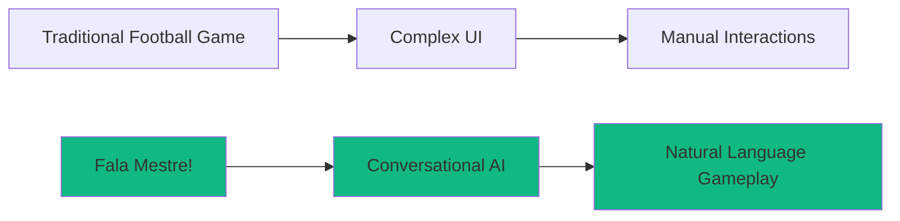
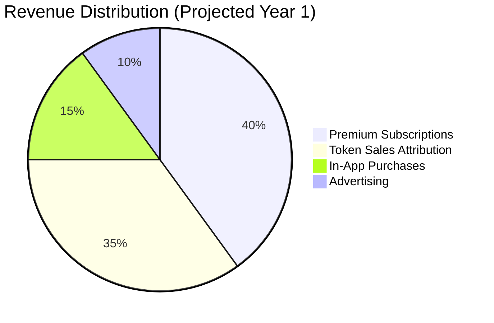

# Executive Summary

---
tags: #overview #executive #business-case
status: complete
priority: critical
phase: planning
last_updated: 2026-01-18
---

## Product Overview

**Fala Mestre!** is a revolutionary AI-powered conversational football management game that transforms how fans engage with the sport they love. By presenting itself as a ChatGPT-style interface that functions as a complete football management simulation, it bridges the gap between accessible mobile gaming and the depth of classic football management games.

> [!tip] Core Innovation
> First-ever conversational football management game globally - players manage their team through natural language, making complex gameplay accessible to everyone.

---

## The Vision

Create the world's most accessible and engaging football management experience that naturally educates users about fan tokens while building the most sophisticated sports marketing platform ever created.



---

## Key Differentiators

| Feature | Traditional Games | Fala Mestre! |
|---------|-------------------|--------------|
| Interface | Complex menus | Natural conversation |
| Learning Curve | Hours/days | Minutes |
| Session Length | 30-60 min | 5-15 min |
| Development Cost | $100K-500K | ~$20K |
| Time to Market | 6-12 months | 2-3 months |
| Real Rewards | Virtual only | Actual fan tokens |
| Data Collection | Click analytics | Rich conversational data |

---

## Business Objectives

### Year 1 Targets

| Objective | Target | Timeline |
|-----------|--------|----------|
| User Acquisition | 100,000 users | Year 1 |
| CAC (Customer Acquisition Cost) | <$1 | Month 6 |
| Token Conversion Rate | 15-20% | Ongoing |
| Monthly Active Users (MAU) | 40,000 | Month 12 |
| D7 Retention | 40%+ | Month 3 |
| Revenue | $400-600K | Year 1 |
| ROI | 2000%+ | Year 1 |

### Investment & Timeline

```yaml
Development Investment: $20,000
Timeline: 
  MVP: 2-4 weeks
  Soft Launch: Week 5
  Public Launch: Week 9
  Full Feature Set: Month 3
  
Break-even: Month 4
First Profitable Month: Month 5
```

---

## Market Opportunity

### Target Market: Brazil

| Metric | Value |
|--------|-------|
| Population | 215 million |
| Football Fans | 70+ million active |
| Mobile Users | 180 million (84% penetration) |
| Mobile Gamers | 101 million (47% of population) |
| Gaming Market Size | $2.3 billion (2024) |
| Current Fan Token Penetration | <0.5% |
| Growth Potential | 100x in 3 years |

> [!note] Why Brazil?
> - Largest football fan base outside Europe
> - Massive mobile adoption
> - Proven appetite for sports gaming
> - Emerging crypto/Web3 awareness
> - Cultural authenticity opportunity

---

## Strategic Positioning

```
                    Complexity
                        ↑
                        │    Football Manager
                        │    (Hardcore)
                        │
                        │              FIFA Mobile
                        │              (Mainstream)
                        │
                        │                      ★ Fala Mestre!
                        │                      (Accessible +
                        │                       Real Rewards)
                        │
                        └──────────────────────────→
                                        Accessibility
```

**Unique Position:** High Accessibility + Real Rewards + AI-Native + Brazilian Focus

---

## Revenue Model

### Revenue Streams



| Stream | Model | Projected (Y1) |
|--------|-------|----------------|
| Premium Pass | $4.99/month subscription | $200K |
| Token Attribution | 10% commission on conversions | $150K |
| In-App Purchases | One-time items, boosts | $75K |
| Advertising | Non-intrusive, optional | $50K |

---

## Competitive Advantages

### 1. First-Mover Advantage
- First AI conversational football game globally
- 6-12 month head start on competitors
- Early brand association with innovation

### 2. Data Network Effects
- More users = better clustering
- Better clustering = better targeting
- Better targeting = lower CAC
- Lower CAC = more users (virtuous cycle)

### 3. Cost Efficiency
- 10x cheaper to build than traditional games
- 80% less time to market
- Lower operating costs
- Higher margins

### 4. Platform Lock-in
- User investment in progress
- Social connections
- Accumulated rewards
- Behavioral data history

---

## Risk Summary

| Risk | Probability | Impact | Mitigation |
|------|------------|--------|------------|
| Low User Adoption | Medium | High | Aggressive marketing, influencer partnerships |
| AI Costs Escalate | Medium | Medium | Caching, model optimization, tiered approach |
| Competitor Entry | High | Medium | Move fast, build data moat, exclusive partnerships |
| Regulatory Issues | Low | High | Legal review, entertainment classification |

See [[02-Risk-Register]] for complete risk analysis.

---

## Success Criteria

### MVP Success (Week 4)
- [ ] 100 beta users complete onboarding
- [ ] >50% play 5+ matches
- [ ] >30% return next day
- [ ] <2 second AI response time
- [ ] <1% error rate

### Soft Launch Success (Week 8)
- [ ] 1,000 users in first month
- [ ] >40% D7 retention
- [ ] >10% premium conversion
- [ ] Viral coefficient >0.5
- [ ] CAC <$2

### Public Launch Success (Week 12)
- [ ] 10,000 users in first month
- [ ] >35% D7 retention
- [ ] >5% premium conversion
- [ ] Viral coefficient >1.0
- [ ] CAC <$1

---

## Next Steps

1. **Immediate:** Begin MVP development sprint
2. **Week 1-2:** Core infrastructure and chat interface
3. **Week 3-4:** Match simulation and basic gameplay
4. **Week 5:** Private beta launch
5. **Week 9:** Public launch

---

## Related Documents

- [[01-Vision-and-Strategy]] - Detailed strategic planning
- [[02-Market-Analysis]] - Complete market research
- [[00-Development-Phases]] - Development roadmap
- [[04-Financial-Projections]] - Detailed financial model
- [[00-Task-Index]] - Implementation tasks

---

*"The question isn't whether to do this, but how fast we can launch before competitors realize what we're building."*
