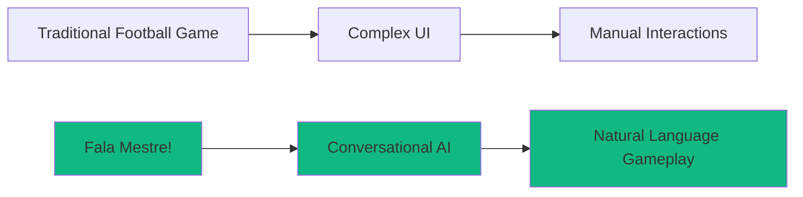

# Executive Summary

---
tags: #overview #executive
status: complete
priority: critical
phase: planning
last_updated: 2026-10-18
---

## Product Overview

**Fala Mestre!** is an AI-powered conversational football management game. It presents itself as a ChatGPT-style chat interface that works as a complete football management simulation, bridging the gap between accessible mobile gaming and the depth of classic football management games.

Fala Mestre! is a standalone game; it has no crypto or ad-platform integrations.

> [!tip] Core Innovation
> A conversational football management game - players manage their team through natural language, making complex gameplay accessible to everyone.

---

## The Vision

Create an accessible and engaging football management experience where every decision can be made by talking to an AI assistant.



---

## Key Differentiators

| Feature | Traditional Games | Fala Mestre! |
|---------|-------------------|--------------|
| Interface | Complex menus | Natural conversation |
| Learning Curve | Hours/days | Minutes |
| Session Length | 30-60 min | 5-15 min |
| Rewards | In-game | In-game (points, club money, unlocks) |

---

## Design Goals

| Goal | Description |
|------|-------------|
| Accessibility | A new player can manage a match within minutes, without reading menus |
| Short sessions | A meaningful session fits in 5-15 minutes on a phone |
| Depth on demand | Squad, tactics, transfers, stadium and youth systems are available for players who want them |
| Responsiveness | AI replies in under ~2 seconds; a mock mode keeps the game playable without an LLM key |
| Brazilian flavour | Portuguese (Brazil) UI and commentary, fictional clubs with local character |

---

## Target Audience

Brazilian football fans who play on mobile and want the strategic side of football management without the complexity of hardcore simulators.

> [!note] Why Brazil?
> - Largest football fan base outside Europe
> - Massive mobile adoption
> - Proven appetite for sports gaming
> - Cultural authenticity opportunity

---

## Strategic Positioning

```
                    Complexity
                        ↑
                        │    Football Manager
                        │    (Hardcore)
                        │
                        │              FIFA Mobile
                        │              (Mainstream)
                        │
                        │                      ★ Fala Mestre!
                        │                      (Accessible +
                        │                       Conversational)
                        │
                        └──────────────────────────→
                                        Accessibility
```

**Unique Position:** High Accessibility + AI-Native + Brazilian Focus

---

## Technical Approach

- Next.js + React front end, mobile-first
- Neon PostgreSQL with Drizzle ORM for game state
- LLM calls through OpenRouter, with a mock mode when no API key is configured
- Deterministic match engine with turn-based decisions during matches

See [[00-System-Overview]] and [[04-AI-LLM-Strategy]] for details.

---

## Risk Summary

| Risk | Probability | Impact | Mitigation |
|------|------------|--------|------------|
| Low player engagement | Medium | High | Short sessions, clear goals, fast feedback loops |
| AI costs escalate | Medium | Medium | Caching, model optimization, tiered approach, mock mode |
| AI response quality | Medium | Medium | Rule-based intent fallback, constrained prompts |

---

## Success Criteria

### MVP Success
- [ ] New players complete onboarding
- [ ] Players play 5+ matches in a session series
- [ ] <2 second AI response time
- [ ] <1% error rate

---

## Next Steps

1. Core infrastructure and chat interface
2. Match simulation and basic gameplay
3. Squad, transfer and club management depth
4. Polish, testing and playtesting

---

## Related Documents

- [[01-Vision-and-Strategy]] - Detailed strategic planning
- [[02-Market-Analysis]] - Market research
- [[00-Development-Phases]] - Development roadmap
- [[00-Task-Index]] - Implementation tasks
