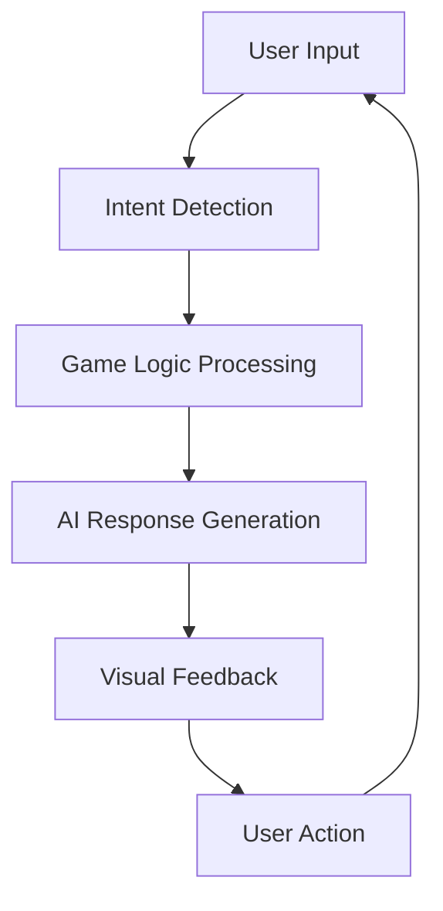
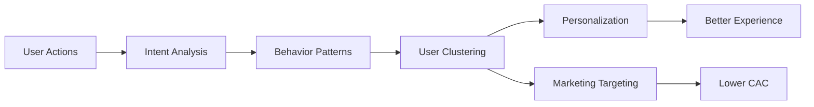
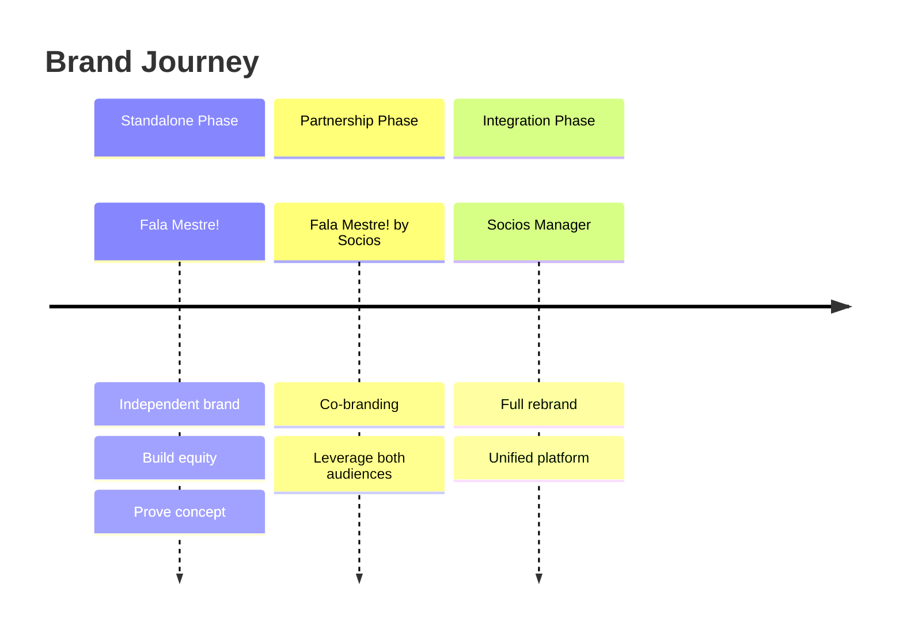

# Vision and Strategy

---
tags: #overview #vision #strategy #planning
status: complete
priority: critical
phase: planning
last_updated: 2026-01-18
---

## Vision Statement

> **"Create the world's most accessible and engaging football management experience that naturally educates users about fan tokens while building the most sophisticated sports marketing platform ever created."**

---

## Mission

Transform how fans engage with football clubs by:

| Pillar | Description |
|--------|-------------|
| **Entertaining** | Providing addictive, accessible gameplay that respects players' time |
| **Rewarding** | Offering real value through fan tokens and meaningful progression |
| **Educating** | Teaching Web3 concepts through natural gameplay, not lectures |
| **Connecting** | Building community around shared passion for football |

---

## Strategic Pillars

### 1. Conversational-First Design

The entire game experience flows through natural language conversation, eliminating traditional UI complexity.



**Why This Matters:**
- Removes learning curve barriers
- Enables accessibility for all skill levels
- Creates shareable, memorable moments
- Reduces development complexity
- Enables rapid iteration through prompt engineering

### 2. Fun First, Tokens Second

> [!important] Core Principle
> "Fun game first; educational benefits come as natural by-products of gameplay."

The game must stand on its own as entertainment. Token rewards enhance but don't define the experience.

| Priority | Element | Implementation |
|----------|---------|----------------|
| 1 | Core Gameplay | Engaging match simulation, satisfying progression |
| 2 | Social Connection | Friend challenges, community events |
| 3 | Personal Expression | Team customization, tactical identity |
| 4 | Real Rewards | Token earning as bonus, not requirement |

### 3. Brazilian Authenticity

Deep cultural integration with Brazilian football culture, not superficial localization.

**Cultural Elements:**
- Authentic team names, players, and competitions
- Brazilian Portuguese narrative style
- Local slang and expressions ("Fala Mestre" itself)
- Regional rivalries and derbies
- State championships and local context
- Match day culture and fan traditions

### 4. Data-Driven Intelligence

Every interaction generates valuable behavioral data for personalization and marketing.



---

## Success Factors

### Must Have (P0)

| Factor | Description | Measurement |
|--------|-------------|-------------|
| Fun Core Gameplay | Addictive Elifoot-style mechanics | D7 retention >40% |
| Fast AI Responses | <1s for most actions | p95 latency <1000ms |
| Fair Reward System | Achievable, transparent earning | NPS >40 |
| Brazilian Authenticity | Cultural accuracy and resonance | User feedback |
| Reliable Infrastructure | 99.9% uptime, no data loss | Monitoring |

### Should Have (P1)

| Factor | Description | Measurement |
|--------|-------------|-------------|
| Social Features | Friend challenges, sharing | Viral coefficient |
| Deep Personalization | Adaptive content and difficulty | Engagement metrics |
| Regular Updates | Fresh content, events | Weekly active rate |
| Cross-Platform | Works on all devices | Device distribution |

### Could Have (P2)

| Factor | Description | Measurement |
|--------|-------------|-------------|
| Voice Interaction | Speak to manage team | Feature adoption |
| Live Match Integration | Sync with real matches | Engagement spikes |
| Esports Tournaments | Competitive leagues | Tournament participation |

---

## Brand Strategy

### Brand Identity

| Element | Decision | Rationale |
|---------|----------|-----------|
| **Name** | Fala Mestre! | Brazilian slang, accessible, memorable |
| **Positioning** | "ChatGPT for Football Manager" | Clear value proposition |
| **Tone** | Passionate but accessible | Appeals to all classes |
| **Domain** | falamestre.ai | Modern, tech-forward |

### Brand Voice

```yaml
Do:
  - Use everyday Brazilian Portuguese
  - Be enthusiastic about football
  - Celebrate user achievements
  - Use appropriate emojis
  - Be helpful and encouraging

Don't:
  - Be condescending about skill level
  - Use overly technical Web3 jargon
  - Push token purchases aggressively
  - Ignore cultural context
  - Be generic or robotic
```

### Brand Evolution



---

## Competitive Strategy

### Positioning Matrix

| Competitor | Our Advantage |
|------------|---------------|
| Football Manager | Accessibility, mobile-first, real rewards |
| FIFA Mobile | Strategy depth, fair progression, no pay-to-win |
| Top Eleven | AI-powered, Brazilian focus, modern tech |
| Fantasy Football | Complete game experience, not just picks |
| Score! Hero | Full management depth, not just action |

### Defensive Moats

1. **Data Moat**
   - Rich conversational data enables better AI
   - User clustering improves targeting
   - More data = better personalization = higher retention

2. **First-Mover Advantage**
   - Establish category leadership
   - Build brand recognition
   - Secure key partnerships

3. **Network Effects**
   - Social features create stickiness
   - Community content generates engagement
   - Word-of-mouth reduces CAC

4. **Technology Moat**
   - Fine-tuned AI models become proprietary
   - Prompt engineering creates competitive advantage
   - Infrastructure optimization reduces costs

---

## Growth Strategy

### Phase 1: Establish (Months 1-3)

**Goal:** Prove product-market fit in Brazil

| Action | Target |
|--------|--------|
| Launch MVP | 1,000 beta users |
| Validate core loop | 40% D7 retention |
| Optimize onboarding | 70% completion rate |
| Build social proof | 100+ positive reviews |

### Phase 2: Accelerate (Months 4-6)

**Goal:** Achieve growth momentum

| Action | Target |
|--------|--------|
| Expand team selection | All Brasileirão teams |
| Launch tournaments | 10,000 participants |
| Influencer campaigns | 50,000 users |
| Premium conversion | 10% of actives |

### Phase 3: Scale (Months 7-12)

**Goal:** Become market leader in Brazil

| Action | Target |
|--------|--------|
| PvP multiplayer | 25% of sessions |
| Club partnerships | 5 official clubs |
| Revenue optimization | $50K MRR |
| International prep | Portuguese (Portugal), Spanish |

### Phase 4: Expand (Year 2+)

**Goal:** International presence

| Action | Target |
|--------|--------|
| European leagues | UK, Spain, Germany |
| Multi-language | 5 languages |
| Global tournaments | Cross-region play |
| Platform partnerships | Major sports apps |

---

## Decision Framework

### Prioritization Matrix

```
                    High Impact
                        ↑
            Quick Wins  │  Strategic
              DO NOW    │  PLAN FOR
                        │
           ─────────────┼─────────────→ High Effort
                        │
            Low Value   │  Avoid/Defer
              SKIP      │  MAYBE LATER
                        │
                    Low Impact
```

### Trade-off Decisions

| Situation | Decision |
|-----------|----------|
| Speed vs. Polish | Speed first, polish iteratively |
| Features vs. Stability | Stability wins |
| AI Cost vs. Quality | Quality for core, cost-optimize edges |
| Monetization vs. UX | Never sacrifice core UX for revenue |
| Growth vs. Retention | Retention is foundation for growth |

---

## Related Documents

- [[00-Executive-Summary]] - Business overview
- [[02-Market-Analysis]] - Market research
- [[03-Go-To-Market]] - Launch strategy
- [[00-Development-Phases]] - Implementation roadmap

---

*Strategy is about making choices. Every choice opens doors and closes others. Choose wisely, execute fiercely.*
