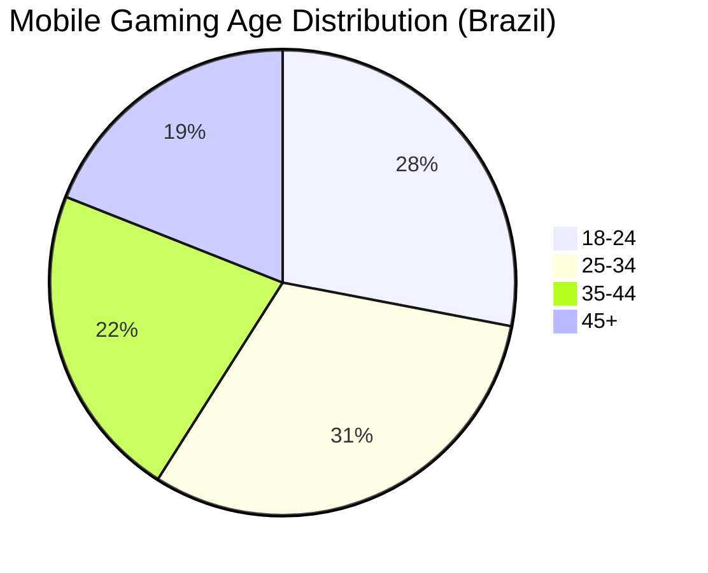
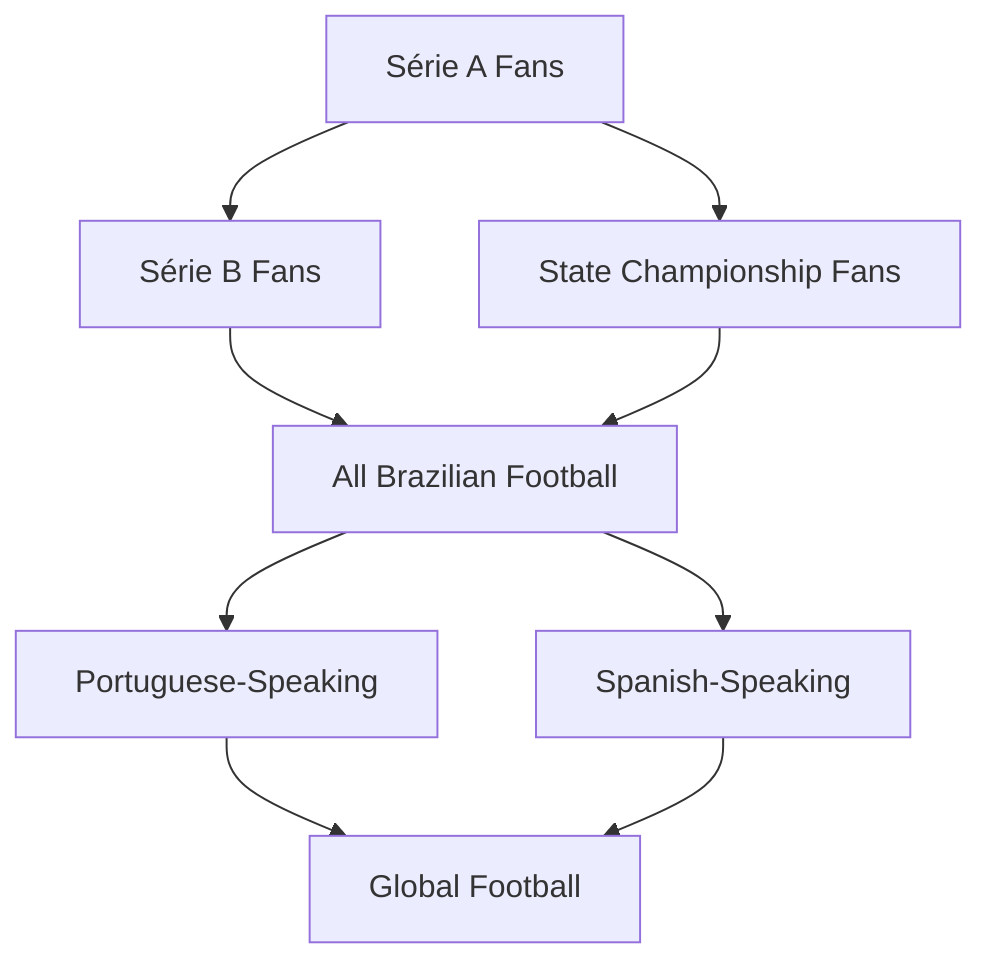

# Market Analysis

---
tags: #overview #market #research #brazil #competition
status: complete
priority: high
phase: planning
last_updated: 2026-01-18
---

## Target Market: Brazil

### Market Size

| Metric | Value | Source |
|--------|-------|--------|
| Population | 215 million | IBGE 2024 |
| Football Fans | 70+ million active | Datafolha |
| Mobile Users | 180 million (84%) | GSMA |
| Mobile Gamers | 101 million (47%) | Newzoo |
| Gaming Market Size | $2.3 billion | Newzoo 2024 |
| Sports Gaming | $520 million | Estimated 23% |

### Demographics



| Segment | Size | Characteristics |
|---------|------|-----------------|
| Young Adults (18-24) | 28% | High engagement, low spending, social-driven |
| Core Gamers (25-34) | 31% | Regular players, moderate spending, competitive |
| Established (35-44) | 22% | Time-constrained, willing to pay, casual |
| Veterans (45+) | 19% | Nostalgic, football fans, growing mobile adoption |

### Behavioral Patterns

| Metric | Value |
|--------|-------|
| Avg Session Length | 15-20 minutes |
| Peak Hours | 7-9 PM weekdays, all day weekends |
| Preferred Genre | Sports (22%), Strategy (18%) |
| Payment Methods | PIX (60%), Credit Card (25%), Boleto (15%) |
| Social Sharing | Very high (WhatsApp, Instagram) |

---

## Competitive Landscape

### Direct Competitors

#### Football Manager (SI Games)

| Aspect | Analysis |
|--------|----------|
| Strengths | Deep simulation, brand recognition, loyal fanbase |
| Weaknesses | Complex, expensive, time-consuming, PC-focused |
| Market Share | Dominant in hardcore segment |
| **Our Advantage** | Accessibility, mobile-first, conversational |

#### FIFA Mobile (EA Sports)

| Aspect | Analysis |
|--------|----------|
| Strengths | EA brand, graphics, licenses |
| Weaknesses | Pay-to-win, shallow management, exploitative |
| Market Share | Largest casual audience |
| **Our Advantage** | Fair progression, strategy depth |

#### Top Eleven (Nordeus)

| Aspect | Analysis |
|--------|----------|
| Strengths | Established player base, social features |
| Weaknesses | Generic teams, aging mechanics, aggressive monetization |
| Market Share | Strong in casual management |
| **Our Advantage** | AI-powered, Brazilian focus, modern tech |

#### Score! Hero (First Touch)

| Aspect | Analysis |
|--------|----------|
| Strengths | Casual gameplay, action-oriented |
| Weaknesses | No management depth, repetitive |
| Market Share | Casual action segment |
| **Our Advantage** | Full management depth + casual UX |

### Indirect Competitors

| Competitor | Overlap | Differentiation |
|------------|---------|-----------------|
| Fantasy Football | Player engagement | We offer full simulation, not just picks |
| Sports Betting | Prediction engagement | Entertainment, not gambling |
| Social Games | Time competition | Sports passion adds depth |

### Competitive Matrix

| Feature | FM | FIFA Mobile | Top Eleven | **Fala Mestre!** |
|---------|-----|-------------|------------|------------------|
| Complexity | High | Medium | Medium | **Low** |
| Brazilian Focus | Limited | Limited | Generic | **Deep** |
| Free to Play | Paid | F2P | F2P | **F2P** |
| Session Length | 60+ min | 20 min | 30 min | **15 min** |
| AI-Powered | No | No | No | **Core** |
| Development Cost | $500K+ | $1M+ | $200K+ | **$20K** |

---

## Market Trends

### Supporting Trends

| Trend | Status | Impact |
|-------|--------|--------|
| AI Adoption | Accelerating | High - validates conversational approach |
| Mobile Gaming Growth | Strong | High - our primary platform |
| 5G Rollout | Expanding | Medium - enables richer experience |
| Social Gaming | Increasing | High - viral mechanics |

### Timing Factors

| Factor | Timeline | Opportunity |
|--------|----------|-------------|
| 2026 World Cup (North America) | July 2026 | Massive Brazil hype window |
| Economic Recovery | 2025-2026 | Disposable income rising |
| Post-Pandemic Mobile Habits | Established | Mobile-first behavior locked in |

---

## Market Entry Strategy

### Beachhead: Brazilian Série A Fans

**Initial Target:** 
- Male, 18-35
- Active football fans (watch weekly)
- Mobile-first
- Moderate tech comfort
- WhatsApp active

**Expansion Path:**



### Geographic Focus

| Phase | Markets | Timeline |
|-------|---------|----------|
| 1 | Brazil (São Paulo, Rio) | Months 1-3 |
| 2 | Brazil (All States) | Months 4-6 |
| 3 | Portugal, Angola | Months 7-12 |
| 4 | Spain, Mexico, Argentina | Year 2 |
| 5 | Europe, Global | Year 2+ |

---

## Total Addressable Market

### TAM Calculation

```
Brazilian Football Fans: 70M
├── Active Mobile Gamers: 45M (64%)
│   ├── Sports Game Players: 10M (22%)
│   │   └── Management Interest: 3M (30%)
```

| Market Level | Size |
|--------------|------|
| TAM (All Brazilian Football Fans) | 70M |
| SAM (Mobile Sports Gamers) | 10M |
| Management-game interest | 3M |

---

## Customer Acquisition

### Channel Strategy

| Channel | CAC Est. | Volume | Priority |
|---------|----------|--------|----------|
| Organic/Viral | $0.10 | High | P0 |
| Influencer | $0.50 | Medium | P0 |
| Social Ads | $1.00 | High | P1 |
| App Store | $2.00 | Medium | P1 |

### Viral Mechanics

| Mechanic | K-Factor Contribution |
|----------|----------------------|
| Match Result Sharing | 0.3 |
| Achievement Badges | 0.2 |
| Friend Challenges | 0.4 |
| Referral Rewards | 0.3 |
| **Total Viral Coefficient** | **1.2** |

---

## Key Insights

> [!important] Blue Ocean Opportunity
> No competitor combines: Conversational AI + Football Management + Brazilian Focus

### Strategic Implications

1. **First-Mover Window:** 6-12 months before potential copycats
2. **Accessibility:** Natural language removes the menu-learning barrier
3. **Cost Efficiency:** AI-native = 10x cheaper development
4. **Cultural Moat:** Brazilian authenticity is hard to replicate

---

## Related Documents

- [[00-Executive-Summary]] - Product overview
- [[01-Vision-and-Strategy]] - Strategic planning
- [[00-User-Personas]] - Target user profiles

---

*Markets don't wait. The opportunity window is open now.*
