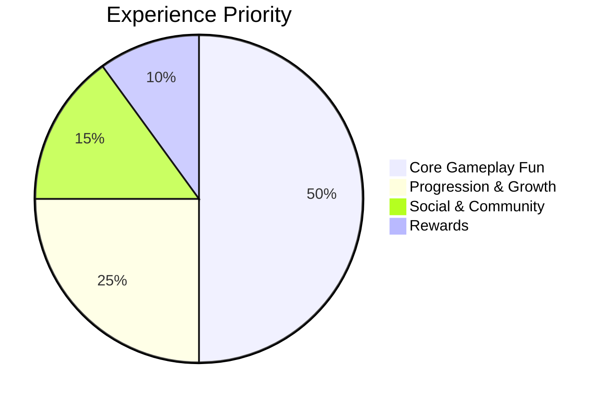
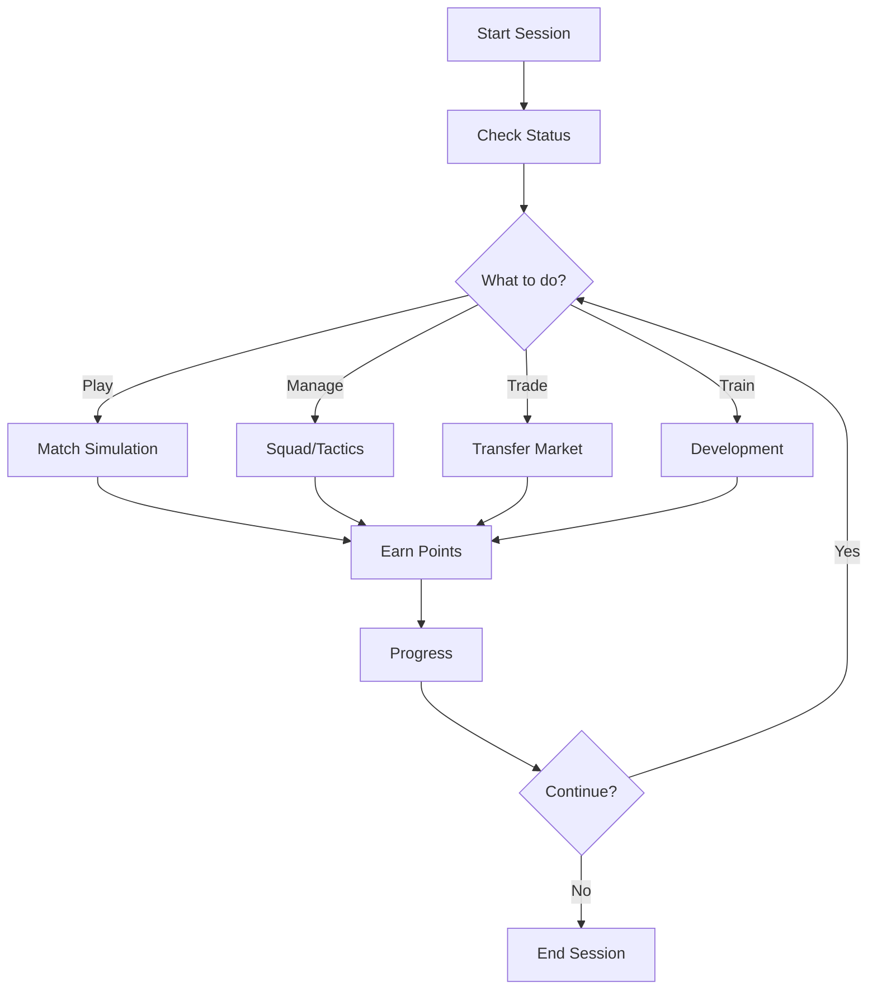

# Core Concept

---
tags: #game-design #concept #philosophy #mvp
status: complete
priority: critical
phase: planning
last_updated: 2026-01-18
---

## The Big Idea

**Fala Mestre!** is "ChatGPT meets Football Manager" - a conversational AI game where players manage a football club through natural language dialogue instead of complex menus and buttons.

> [!tip] One-Line Pitch
> "What if you could manage your favorite football club just by talking to it?"

---

## Core Philosophy

### 1. Conversation is the Controller

The entire game interface is a chat. No complex UI, no learning curve, no barriers.

```
Traditional Game:
Menu → Sub-menu → Button → Confirmation → Result

Fala Mestre!:
"Contratar O Mago" → AI Response with options → "Offer 5 million" → Done
```

### 2. Football Comes First

The game must be fun independently of rewards. It's a football game that happens to reward players, not a rewards platform with football theming.



### 3. Authenticity Over Simulation

We prioritize emotional authenticity over statistical precision. The game should *feel* like Brazilian football, even if some mechanics are simplified.

| Authentic | Not Authentic |
|-----------|---------------|
| Rivalry passion | Complex injury models |
| Fan reactions | Detailed financial reports |
| Dramatic narratives | Player contract negotiations |
| Local slang | Transfer clauses |

### 4. Accessible Depth

Simple to start, deep to master. First match in 5 minutes, tactical mastery in months.

```
Minute 1:  Pick your team
Minute 3:  Play first match
Minute 5:  Win and earn points
Hour 1:    Understand tactics
Week 1:    Master transfers
Month 1:   Deep tactical knowledge
```

---

## Game Identity

### What We Are

| Attribute | Description |
|-----------|-------------|
| **Genre** | Conversational Football Management |
| **Platform** | Mobile-first web app (PWA) |
| **Session Length** | 5-15 minutes |
| **Monetization** | Free-to-play with optional premium |
| **Core Loop** | Manage → Play → Earn → Improve |
| **Tone** | Passionate, accessible, Brazilian |

### What We're NOT

| Not This | Why |
|----------|-----|
| Action game | No real-time player control |
| Simulation | Not obsessed with realism |
| P2W | Skill matters more than money |
| Time sink | Respect players' time |

---

## The Elifoot Foundation

The game mechanics are inspired by **Elifoot**, a beloved Brazilian football management game from the 1990s-2000s.

### Why Elifoot?

1. **Proven Fun:** Generations of Brazilians grew up with it
2. **Simple Core:** Easy to understand, hard to master
3. **Brazilian DNA:** Built for Brazilian football context
4. **Nostalgia Factor:** Emotional connection for 30+ audience
5. **Text-Based Roots:** Perfect fit for conversational format

### Elifoot Elements We Adopt

| Element | Implementation |
|---------|----------------|
| Turn-based seasons | Week-by-week progression |
| Simple player ratings | 60-99 scale, 6 attributes |
| Match simulation | Probability-based outcomes |
| Budget management | Income/expense balance |
| Youth development | Academy system |
| Rivalries | Derby bonuses and drama |

### Where We Innovate

| Elifoot Limitation | Our Innovation |
|--------------------|----------------|
| Static UI | Conversational interface |
| Single-player only | Social and PvP features |
| No rewards | Achievements, unlocks and in-game rewards |
| Limited narratives | AI-generated drama |
| Manual everything | Smart suggestions |

---

## Core Game Loop



### Loop Timings

| Activity | Time | Frequency |
|----------|------|-----------|
| Quick match | 2-3 min | Multiple per session |
| Squad review | 1-2 min | Once per session |
| Transfer | 3-5 min | 2-3 per week |
| Training | 1 min | Daily |
| Tournament | 10-15 min | Weekly |

---

## Engagement Pillars

### 1. Immediate Gratification

Every session provides:
- A match to play
- A decision to make
- Points to earn
- Progress to see

### 2. Long-term Goals

Players work toward:
- League titles
- Player development
- Team upgrades
- Unlock milestones

### 3. Social Validation

Players share:
- Match results
- Achievements
- Rivalries
- Tournaments

### 4. Personalization

Players express:
- Tactical identity
- Transfer philosophy
- Team culture
- Management style

---

## Unique Selling Points

### 1. First Conversational Football Game

Nobody else has done this. The interface IS the innovation.

### 2. Meaningful Progression

Points, club money and unlocks reflect real decisions made in the game.

### 3. Brazilian Authenticity

Made for Brazilian fans, by someone who understands the culture.

### 4. AI-Powered Narratives

Every match is unique. Every negotiation is different. AI generates endless variety.

### 5. Respectful of Time

Play a meaningful session in your commute, lunch break, or before bed.

---

## Design Principles

### 1. One Tap Rule

Any common action should be achievable in one tap/message.

```
Good: "Jogar próximo jogo"
Bad: Menu → Schedule → Next Match → Confirm → Start
```

### 2. Smart Defaults

The game suggests sensible options. Players can customize or just accept.

```
AI: "Your best lineup is ready. Start the match?"
[Accept] [Customize] [Ask why]
```

### 3. Celebrate Everything

Make players feel good about their choices and achievements.

```
Small win: "Great choice! Your team's morale just increased."
Big win: "CHAMPION! 🏆 You've led [Team] to glory!"
```

### 4. Never Punish

Losing teaches, it doesn't punish. No "energy" systems that block play.

```
After loss: "Tough result, but I see how we can improve. 
Want to adjust tactics or just move forward?"
```

### 5. Always Forward

There's always something to do, always progress to make.

```
No dead ends. Every action leads to another opportunity.
```

---

## The Conversational Advantage

### Why This Works

| Traditional UI | Conversational |
|----------------|----------------|
| Learn menus | Just ask |
| Find buttons | Describe intent |
| Remember locations | Natural language |
| Fixed options | Open ended |
| Same for everyone | Personalized |

### What It Enables

1. **Zero Onboarding:** Just start chatting
2. **Accessibility:** Works for all skill levels
3. **Shareability:** Conversations are screenshottable
4. **Personality:** AI has character and wit
5. **Flexibility:** Add features without UI redesign

---

## Target Experience

### First Session (5 minutes)

```
1. Open app
2. "Welcome! Create your team" → Name it, pick colors, choose badge
3. "Great choice! Ready for your first match?" → Yes
4. [Match simulation with narrative]
5. "You won 2-1! You earned 100 points. What next?"
6. Player hooked, understands the game
```

### Regular Session (10-15 minutes)

```
1. "Good morning! Your next match is against Leões do Norte"
2. Check team status
3. Make one tactical adjustment
4. Play match
5. Review results
6. Quick transfer check
7. "See you tomorrow for the big match!"
```

### Deep Session (30+ minutes)

```
Tournament day, multiple matches
In-depth transfer negotiations
Youth academy management
Tactical experimentation
Social challenges with friends
```

---

## Success Metrics

| Metric | Target | Measurement |
|--------|--------|-------------|
| Time to First Match | <3 minutes | Analytics |
| First Session Length | >10 minutes | Analytics |
| D1 Retention | >60% | Cohort analysis |
| Messages per Session | >20 | Chat logs |
| "Fun" NPS | >40 | Surveys |

---

## Related Documents

- [[01-Gameplay-Loop]] - Detailed mechanics
- [[03-Match-Simulation]] - Match engine
- [[03-Conversational-Interface]] - UI design
- [[01-User-Journey]] - Player experience
- [[19-IP-Protection-Team-Naming-Strategy]] - IP-safe team naming approach

---

*"Make something people want, then make it accessible to everyone."*
