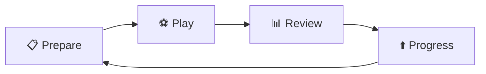
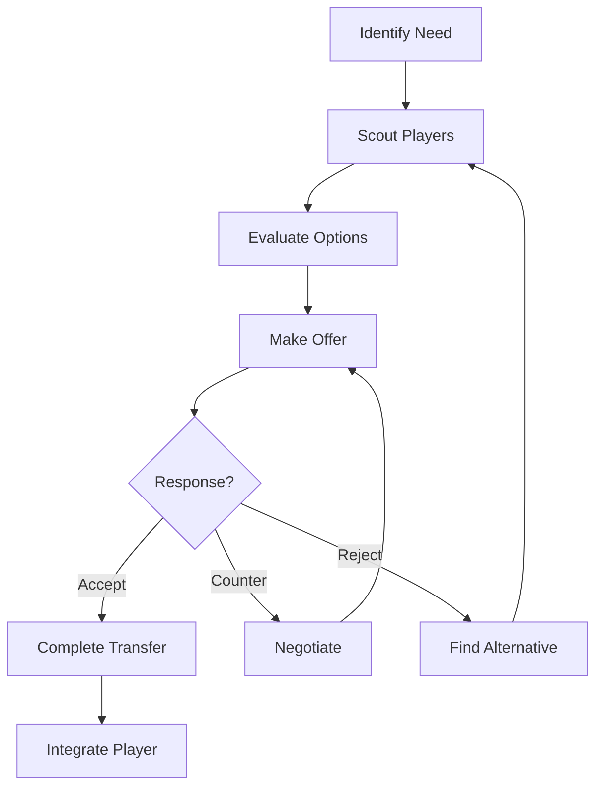
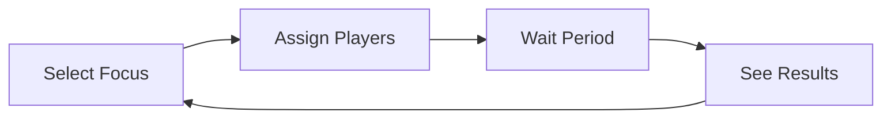
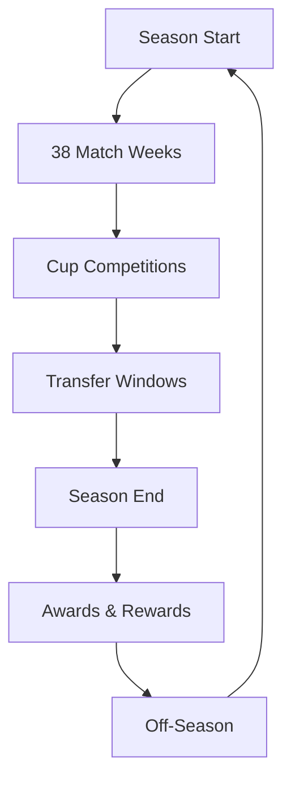
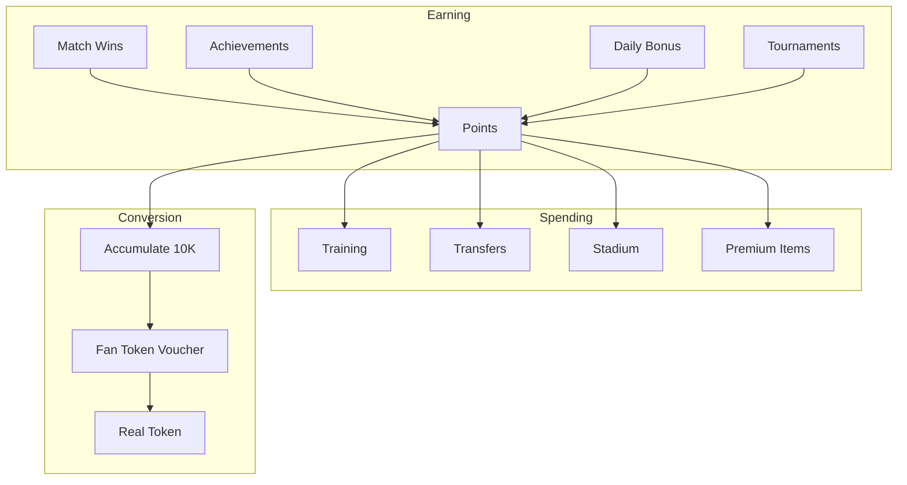

# Gameplay Loop

---
tags: #game-design #gameplay #loop #mechanics #mvp
status: complete
priority: critical
phase: planning
last_updated: 2026-01-18
---

## Primary Loop

The core gameplay loop that players repeat multiple times per session.



### 1. Prepare (1-2 minutes)

| Action | Description |
|--------|-------------|
| Check lineup | Review starting XI and fitness |
| Adjust tactics | Formation, mentality, focus |
| Assess opponent | Strengths, weaknesses, history |
| Set expectations | Identify key matchups |

### 2. Play (2-3 minutes)

| Action | Description |
|--------|-------------|
| Match simulation | AI-generated narrative |
| Key moments | Goals, cards, injuries, drama |
| Decision points | Substitutions, tactical changes |
| Result | Final score and statistics |

### 3. Review (1 minute)

| Action | Description |
|--------|-------------|
| Match summary | Key events and stats |
| Player ratings | Individual performances |
| Points earned | Rewards calculation |
| Standings update | League position change |

### 4. Progress (1-2 minutes)

| Action | Description |
|--------|-------------|
| Spend points | Training, upgrades, transfers |
| Check achievements | New milestones unlocked |
| Plan ahead | Next match preview |
| Share success | Social features |

---

## Secondary Loops

### Transfer Loop (Weekly)



**Frequency:** 2-5 transfers per season
**Session Time:** 3-10 minutes per transfer

### Training Loop (Daily)



**Frequency:** Daily
**Session Time:** 30 seconds to 2 minutes

### Season Loop (Monthly)



**Duration:** ~1 month real-time (accelerated)
**Matches:** 38 league + 6-12 cup matches

---

## Session Types

### Quick Session (5 minutes)

```yaml
Actions:
  - Play 1-2 matches
  - Collect daily bonus
  - Quick team check
  
Best For:
  - Commute
  - Break time
  - Before bed
  
Rewards:
  - 100-200 points
  - Match progression
```

### Standard Session (15 minutes)

```yaml
Actions:
  - Play 3-5 matches
  - Tactical adjustments
  - One transfer activity
  - Training assignments
  
Best For:
  - Lunch break
  - Evening wind-down
  
Rewards:
  - 300-500 points
  - Meaningful progress
```

### Deep Session (30+ minutes)

```yaml
Actions:
  - Tournament participation
  - Multiple transfers
  - Strategic planning
  - Social features
  - Detailed analysis
  
Best For:
  - Weekend gaming
  - Dedicated sessions
  
Rewards:
  - 500-1000+ points
  - Major achievements
```

---

## Progression Systems

### Short-term Progression (Daily)

| System | Mechanic | Reward |
|--------|----------|--------|
| Daily Login | Show up | 10-50 points |
| Match Play | Win games | 50-150 points |
| Achievements | Hit milestones | 100-500 points |

### Medium-term Progression (Weekly)

| System | Mechanic | Reward |
|--------|----------|--------|
| Win Streaks | Consecutive wins | Multiplier bonus |
| Weekly Tournament | Compete | 500-2000 points |
| Transfer Success | Good deals | Achievement + points |

### Long-term Progression (Monthly/Season)

| System | Mechanic | Reward |
|--------|----------|--------|
| League Position | Final standing | 1000-10000 points |
| Cup Run | Tournament depth | 500-5000 points |
| Player Development | Youth → Star | Achievement + value |
| Fan Token Voucher | 10,000 points | Real token |

---

## Engagement Mechanics

### Daily Hooks

| Hook | Description | Retention Impact |
|------|-------------|------------------|
| Daily Bonus | Points for logging in | High |
| Streak Rewards | Consecutive days | Very High |
| Match Schedule | "Next match in X hours" | Medium |
| Push Notifications | Key events | Medium |

### Weekly Hooks

| Hook | Description | Retention Impact |
|------|-------------|------------------|
| Weekend Tournament | Big competition | High |
| Transfer Deadline | Time pressure | High |
| Derby Match | Rivalry games | Very High |
| Leaderboard Reset | Fresh competition | Medium |

### Monthly Hooks

| Hook | Description | Retention Impact |
|------|-------------|------------------|
| Season Climax | Title/relegation drama | Very High |
| New Season | Fresh start | High |
| Special Events | Holiday themes | Medium |
| Major Rewards | Token vouchers | Very High |

---

## Difficulty Curve

```
Week 1:  🟢🟢🟢⚪⚪⚪⚪⚪⚪⚪  Easy wins, learning
Week 2:  🟢🟢🟢🟡🟡⚪⚪⚪⚪⚪  Some challenge
Week 3:  🟢🟢🟡🟡🟡🟡⚪⚪⚪⚪  Regular competition
Week 4+: 🟢🟡🟡🟡🔴🔴⚪⚪⚪⚪  Full challenge
```

### Adaptive Difficulty

The AI adjusts to player skill level:

| Skill Level | Opponent Quality | Win Rate Target |
|-------------|------------------|-----------------|
| Beginner | Reduced | 70-80% |
| Learning | Normal-low | 60-70% |
| Competent | Normal | 50-60% |
| Expert | Enhanced | 45-55% |

### Difficulty Sources

| Source | Control |
|--------|---------|
| Opponent quality | Matchmaking/AI |
| Tactical counters | AI intelligence |
| Random events | Probability tuning |
| Critical moments | Narrative pacing |

---

## Economy Flow



### Balance Targets

| Metric | Target |
|--------|--------|
| Points per hour (casual) | 150-200 |
| Points per hour (active) | 300-400 |
| Time to first voucher | 30-50 hours |
| Weekly earning cap | 5,000 points |

---

## Emotional Journey

### Per Match

```
Pre-match:   Anticipation, strategy planning
Kickoff:     Excitement, hope
Mid-match:   Tension, engagement
Climax:      Peak emotion (goal/miss/save)
Result:      Satisfaction or determination
```

### Per Season

```
Early:       Optimism, building
Mid:         Pressure, decisions matter
Late:        Drama, high stakes
End:         Triumph or reflection
Off-season:  Planning, fresh hope
```

---

## Feedback Loops

### Positive Reinforcement

| Action | Feedback | Effect |
|--------|----------|--------|
| Win match | Celebration, points | Repeat play |
| Good transfer | Player performs | Confidence |
| Achievement | Badge, announcement | Pride |
| Streak | Multiplier, praise | Commitment |

### Recovery Mechanics

| Setback | Recovery | Player Feeling |
|---------|----------|----------------|
| Lose match | "Learn from this" | Hopeful |
| Bad transfer | Trade/develop | Not stuck |
| Relegation | Rebuild narrative | Fresh start |
| Losing streak | Easier next match | Comeback |

---

## Social Integration

### Competitive

| Feature | Loop Integration |
|---------|------------------|
| Friend Challenges | Quick match alternative |
| Leaderboards | Weekly motivation |
| Tournaments | Deep session content |
| Rivalries | Narrative enhancement |

### Cooperative

| Feature | Loop Integration |
|---------|------------------|
| Clubs/Alliances | Long-term goals |
| Team Events | Special rewards |
| Tip Sharing | Community learning |

### Sharing

| Trigger | Shareable Content |
|---------|-------------------|
| Big win | Match result card |
| Achievement | Badge graphic |
| Transfer | Signing announcement |
| Championship | Trophy celebration |

---

## Loop Metrics

### Health Indicators

| Metric | Healthy Range | Action if Outside |
|--------|---------------|-------------------|
| Session length | 8-20 min | Adjust pacing |
| Sessions/day | 1-3 | Tune notifications |
| Actions/session | 15-40 | Add/remove friction |
| Win rate | 50-65% | Adjust difficulty |

### Warning Signs

| Sign | Possible Issue | Solution |
|------|---------------|----------|
| <5 min sessions | Too easy/boring | Add depth |
| >30 min sessions | Addictive patterns | Add breaks |
| Declining sessions | Losing interest | New content |
| High abandon rate | Frustration | Reduce difficulty |

---

## Related Documents

- [[00-Core-Concept]] - Game philosophy
- [[03-Match-Simulation]] - Match mechanics
- [[08-Points-Rewards]] - Economy details
- [[01-User-Journey]] - Player experience

---

*"The best games teach their depth through play, not tutorials."*
