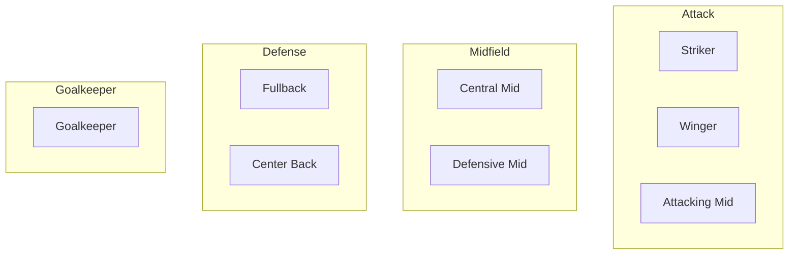

# Player System

---
tags: #game-design #players #attributes #ratings #mvp
status: complete
priority: critical
phase: planning
last_updated: 2026-01-18
---

## Overview

Every football player in Fala Mestre! has attributes that determine their in-game performance. The system balances simplicity (easy to understand) with depth (meaningful differences between players).

---

## Core Attributes

Six primary attributes rated from **60-99**:

| Attribute | Code | Description | Key For |
|-----------|------|-------------|---------|
| **Pace** | PAC | Speed and acceleration | Wingers, strikers, fullbacks |
| **Shooting** | SHO | Finishing, power, accuracy | Strikers, attacking midfielders |
| **Passing** | PAS | Vision, short/long pass quality | Midfielders, playmakers |
| **Dribbling** | DRI | Ball control, agility, skill | Wingers, creative players |
| **Defending** | DEF | Tackling, positioning, marking | Defenders, defensive midfielders |
| **Physical** | PHY | Strength, stamina, jumping | All positions, varies by role |

### Rating Scale

| Range | Description | Example Players |
|-------|-------------|-----------------|
| 60-69 | Below Average | Série B bench players |
| 70-74 | Average | Regular Brasileirão starters |
| 75-79 | Good | Top Brasileirão players |
| 80-84 | Very Good | Elite Brazilian league players |
| 85-89 | Excellent | National team level |
| 90-94 | World Class | International stars |
| 95-99 | Legendary | All-time greats |

---

## Overall Rating Calculation

The Overall rating is calculated using **position-weighted** formulas:

### Position Weights

```typescript
const POSITION_WEIGHTS = {
  GK: { pac: 5,  sho: 0,  pas: 10, dri: 5,  def: 65, phy: 15 },
  CB: { pac: 10, sho: 5,  pas: 15, dri: 5,  def: 50, phy: 15 },
  FB: { pac: 20, sho: 5,  pas: 15, dri: 10, def: 35, phy: 15 },
  DM: { pac: 10, sho: 10, pas: 25, dri: 15, def: 25, phy: 15 },
  CM: { pac: 15, sho: 10, pas: 30, dri: 20, def: 10, phy: 15 },
  AM: { pac: 15, sho: 20, pas: 25, dri: 25, def: 5,  phy: 10 },
  WG: { pac: 25, sho: 15, pas: 15, dri: 30, def: 0,  phy: 15 },
  ST: { pac: 25, sho: 35, pas: 10, dri: 20, def: 0,  phy: 10 }
};
```

### Calculation Example

```
Player: Lucas Ferreira 'Raio' (Striker)
- PAC: 88 → 88 × 0.25 = 22.0
- SHO: 91 → 91 × 0.35 = 31.85
- PAS: 78 → 78 × 0.10 = 7.8
- DRI: 85 → 85 × 0.20 = 17.0
- DEF: 35 → 35 × 0.00 = 0.0
- PHY: 81 → 81 × 0.10 = 8.1

Overall = 22.0 + 31.85 + 7.8 + 17.0 + 0.0 + 8.1 = 86.75 → 87
```

---

## Hidden Attributes

Attributes not visible to players but affecting gameplay:

| Attribute | Range | Description | Impact |
|-----------|-------|-------------|--------|
| **Potential** | 60-99 | Maximum achievable rating | Development ceiling |
| **Consistency** | 0-100 | Performance variance | Match-to-match reliability |
| **Big Match** | 0-100 | Important game performance | Finals, derbies boost |
| **Leadership** | 0-100 | Team morale influence | Captain effectiveness |
| **Work Rate** | 0-100 | Defensive contribution | Pressing, tracking back |
| **Injury Prone** | 0-100 | Injury risk | Availability |
| **Weak Foot** | 1-5 | Non-dominant foot ability | Shooting versatility |
| **Skill Moves** | 1-5 | Dribbling variety | Beating defenders |

### How Hidden Attributes Work

**Potential:**
```
Maximum Rating = min(99, Potential)
Young players can grow to Potential through training
Veterans decline regardless of Potential
```

**Consistency:**
```
High (80+): Reliable, always near base rating
Medium (50-79): Some variance, occasional great/poor games
Low (<50): Unpredictable, big swings in performance
```

**Big Match Player:**
```
In important matches (finals, derbies, title deciders):
Rating Boost = BigMatch / 20 (0-5 points)

Example: BigMatch 90 = +4.5 rating in finals
```

---

## Dynamic Attributes

Attributes that change during gameplay:

| Attribute | Range | Changes Based On | Effect |
|-----------|-------|------------------|--------|
| **Morale** | 0-100 | Results, playing time, events | Performance ±15% |
| **Fitness** | 0-100 | Matches, rest, training | Performance, injury risk |
| **Form** | 0-100 | Recent match performance | Performance ±10% |
| **Sharpness** | 0-100 | Match minutes, training | Readiness to play |

### Effective Rating Formula

```typescript
function getEffectiveRating(player: Player): number {
  const base = player.overall;
  
  // Morale: ±15% (neutral at 50)
  const moraleMod = (player.morale - 50) * 0.003;
  
  // Fitness: 0% to -20% (full fitness = 100)
  const fitnessMod = (player.fitness - 100) * 0.002;
  
  // Form: ±10% (neutral at 50)
  const formMod = (player.form - 50) * 0.002;
  
  const effective = base * (1 + moraleMod + fitnessMod + formMod);
  
  return Math.round(Math.max(60, Math.min(99, effective)));
}
```

### Example Calculation

```
Base Rating: 85
Morale: 70 (+20 above neutral) → +6%
Fitness: 90 (-10 below full) → -2%
Form: 80 (+30 above neutral) → +6%

Effective = 85 × 1.10 = 93.5 → 94
```

---

## Player Positions

### Position Categories



### Position Flexibility

Some players can play multiple positions:

| Primary | Compatible | Performance Penalty |
|---------|------------|---------------------|
| ST | AM, WG | -5% |
| WG | AM, ST | -5% |
| AM | CM, WG | -3% |
| CM | DM, AM | -3% |
| DM | CM, CB | -5% |
| FB | WG, CB | -5% |
| CB | DM, FB | -5% |
| GK | None | N/A |

---

## Player Development

### Age-Based Growth


| Age Range | Weekly Potential Change | Notes |
|-----------|-------------------------|-------|
| 16-20 | +0.3 to +0.5 | Rapid development |
| 21-24 | +0.1 to +0.3 | Continued growth |
| 25-29 | -0.05 to +0.1 | Peak years |
| 30-32 | -0.1 to 0 | Early decline |
| 33+ | -0.2 to -0.1 | Clear decline |

### Training Impact

Training can enhance natural development:

| Training Type | Attributes Affected | Max Weekly Gain |
|---------------|---------------------|-----------------|
| Technical | DRI, PAS, SHO | +0.3 |
| Physical | PAC, PHY | +0.4 |
| Tactical | PAS, DEF | +0.2 |
| Mental | Consistency, BigMatch | +0.5 |

See [[05-Training-Development]] for full training system.

---

## Player Valuation

### Base Value Formula

```typescript
function calculateValue(player: Player): number {
  // Base value from rating (exponential)
  const baseValue = Math.pow(player.overall, 2.5) * 10000;
  // Example: 85 OVR = 85^2.5 × 10000 ≈ R$12.5M
  
  // Age modifier
  let ageMod = 1.0;
  if (player.age < 24) {
    ageMod = 0.8 + (player.age / 24) * 0.6; // Youth premium
  } else if (player.age >= 30) {
    ageMod = Math.max(0.3, 1.0 - (player.age - 29) * 0.15);
  }
  
  // Form modifier
  const formMod = 0.7 + (player.form / 100) * 0.6;
  
  // Potential modifier (young players)
  let potentialMod = 1.0;
  if (player.age < 24 && player.potential > player.overall + 10) {
    potentialMod = 1.3 + (player.potential - player.overall) / 20;
  }
  
  // Position scarcity
  const posMod = { GK: 0.85, CB: 0.95, FB: 0.95, DM: 1.0, CM: 1.05, AM: 1.1, WG: 1.1, ST: 1.15 };
  
  return baseValue * ageMod * formMod * potentialMod * posMod[player.position];
}
```

### Value Ranges by Rating

| Rating | Approximate Value |
|--------|-------------------|
| 70 | R$ 500K - 1M |
| 75 | R$ 2M - 4M |
| 80 | R$ 5M - 10M |
| 85 | R$ 12M - 25M |
| 90 | R$ 40M - 80M |
| 95 | R$ 100M+ |

---

## Player Database

### Initial Player Pool

| League | Teams | Players/Team | Total |
|--------|-------|--------------|-------|
| Brasileirão Série A | 20 | 25-30 | ~550 |
| Brasileirão Série B | 20 | 22-25 | ~470 |
| Youth Pool | - | - | ~200 |
| **Total** | | | **~1,220** |

### Player Generation

For youth and generated players:

```typescript
function generatePlayer(options: GeneratorOptions): Player {
  return {
    name: generateBrazilianName(),
    age: 16 + Math.floor(Math.random() * 4),
    position: options.position || randomPosition(),
    
    // Base attributes near average
    pac: 60 + Math.floor(Math.random() * 20),
    sho: 60 + Math.floor(Math.random() * 20),
    pas: 60 + Math.floor(Math.random() * 20),
    dri: 60 + Math.floor(Math.random() * 20),
    def: 60 + Math.floor(Math.random() * 20),
    phy: 60 + Math.floor(Math.random() * 20),
    
    // Hidden attributes
    potential: 70 + Math.floor(Math.random() * 25),
    consistency: 40 + Math.floor(Math.random() * 40),
    bigMatch: 30 + Math.floor(Math.random() * 50),
    
    // Dynamic attributes start neutral
    morale: 70,
    fitness: 100,
    form: 50,
    sharpness: 80
  };
}
```

---

## Player Cards

### Display Format

```
┌─────────────────────────┐
│  87  │ ST              │
├──────┴─────────────────┤
│                        │
│    LUCAS FERREIRA      │
│         "Raio"         │
│                        │
├────────────────────────┤
│ PAC 88 │ DRI 85        │
│ SHO 91 │ DEF 35        │
│ PAS 78 │ PHY 81        │
├────────────────────────┤
│ Age: 27 │ Value: R$25M │
│ Form: ⭐⭐⭐⭐          │
└─────────────────────────┘
```

### Compact Format (Chat)

```
👤 Raio (87 ST) - PAC 88 | SHO 91 | Form: 🔥
```

---

## Related Documents

- [[03-Match-Simulation]] - How attributes affect matches
- [[05-Training-Development]] - Player improvement
- [[04-Transfer-Market]] - Trading players
- [[02-Database-Schema]] - Data storage
- [[19-IP-Protection-Team-Naming-Strategy]] - Player name generation approach

---

*"Every player tells a story. Attributes are just the beginning."*
