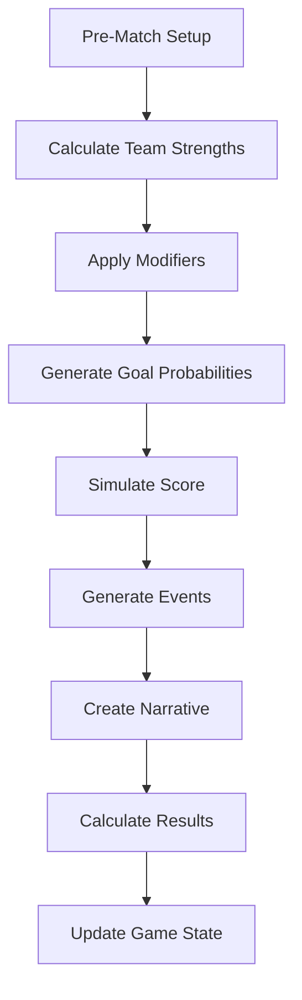
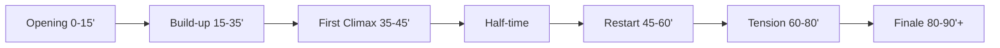

# Match Simulation

---
tags: #game-design #match #simulation #engine #mvp
status: complete
priority: critical
phase: planning
last_updated: 2026-01-18
---

## Overview

The match simulation engine is the heart of Fala Mestre!. It transforms player attributes, tactics, and randomness into exciting match narratives that feel authentic to Brazilian football.

> [!important] Core Principle
> 70% skill-based, 30% random - good management usually wins, but surprises happen like in real football.

---

## Match Flow



---

## Team Strength Calculation

### Step 1: Position Group Ratings

```typescript
function calculateTeamStrength(team: Team): TeamStrength {
  const lineup = team.startingXI;
  
  // Attack strength (forwards)
  const attackers = lineup.filter(p => isAttacker(p));
  const attackRating = average(attackers.map(p => 
    (p.sho * 0.5 + p.pac * 0.3 + p.dri * 0.2) * 
    getMoraleMultiplier(p) * 
    getFitnessMultiplier(p)
  ));
  
  // Midfield strength
  const midfielders = lineup.filter(p => isMidfielder(p));
  const midfieldRating = average(midfielders.map(p =>
    (p.pas * 0.4 + p.dri * 0.3 + p.phy * 0.3) *
    getMoraleMultiplier(p) *
    getFitnessMultiplier(p)
  ));
  
  // Defense strength
  const defenders = lineup.filter(p => isDefender(p));
  const defenseRating = average(defenders.map(p =>
    (p.def * 0.5 + p.phy * 0.3 + p.pac * 0.2) *
    getMoraleMultiplier(p) *
    getFitnessMultiplier(p)
  ));
  
  // Goalkeeper
  const gk = lineup.find(p => p.position === 'GK');
  const gkRating = gk.def * 
    getMoraleMultiplier(gk) * 
    getFitnessMultiplier(gk);
  
  return {
    attack: attackRating,
    midfield: midfieldRating,
    defense: (defenseRating + gkRating) / 2,
    overall: (attackRating + midfieldRating + defenseRating + gkRating) / 4
  };
}
```

### Step 2: Morale & Fitness Multipliers

```typescript
function getMoraleMultiplier(player: Player): number {
  // Range: 0.85 (morale 0) to 1.15 (morale 100)
  return 0.85 + (player.morale / 100) * 0.30;
}

function getFitnessMultiplier(player: Player): number {
  // Range: 0.80 (fitness 0) to 1.00 (fitness 100)
  return 0.80 + (player.fitness / 100) * 0.20;
}
```

---

## Match Modifiers

### Home Advantage

```typescript
const HOME_ADVANTAGE = 1.10; // +10% to home team
```

**Breakdown:**
- +5% from crowd support
- +3% from familiar environment
- +2% from no travel fatigue

### Tactical Modifiers

```typescript
const MENTALITY_MODS = {
  attacking:  { attack: 1.15, defense: 0.90 },
  balanced:   { attack: 1.00, defense: 1.00 },
  defensive:  { attack: 0.90, defense: 1.15 }
};

const PRESSING_MODS = {
  high:   { midfield: 1.10, defense: 0.95 },
  medium: { midfield: 1.00, defense: 1.00 },
  low:    { midfield: 0.95, defense: 1.05 }
};
```

### Formation Modifiers

| Formation | Attack | Midfield | Defense |
|-----------|--------|----------|---------|
| 4-3-3 | 1.10 | 1.00 | 0.95 |
| 4-4-2 | 1.00 | 1.05 | 1.00 |
| 3-5-2 | 0.95 | 1.15 | 0.95 |
| 5-3-2 | 0.85 | 0.95 | 1.20 |
| 4-2-3-1 | 1.05 | 1.10 | 1.00 |

### Formation Matchups

```typescript
const TACTICAL_ADVANTAGES = {
  '4-3-3': { 
    strong_vs: ['4-4-2', '5-3-2'],   // Wide beats narrow
    weak_vs: ['3-5-2', '4-2-3-1']    // Outnumbered midfield
  },
  '3-5-2': { 
    strong_vs: ['4-3-3', '4-4-2'],   // Midfield dominance
    weak_vs: ['4-3-3-wide', '5-3-2'] // Wide exploitation
  },
  '5-3-2': {
    strong_vs: ['4-3-3', '4-4-2'],   // Defensive solidity
    weak_vs: ['4-2-3-1', '3-5-2']    // Lack of width
  }
};

// Tactical advantage: +5% / Disadvantage: -5%
```

### Fan Mood Impact

```typescript
function getFanMoodModifier(fanMood: number, isHome: boolean): number {
  if (!isHome) return 1.0;
  
  // Home team gets boost/penalty from fan mood
  if (fanMood >= 90) return 1.15;      // Euphoric fans
  if (fanMood >= 70) return 1.05;      // Happy fans
  if (fanMood >= 50) return 1.00;      // Neutral
  if (fanMood >= 30) return 0.95;      // Unhappy fans
  return 0.85;                          // Hostile atmosphere
}
```

---

## Goal Probability

### Expected Goals (xG) Calculation

```typescript
function calculateExpectedGoals(
  attackStrength: number,
  defenseStrength: number,
  isHome: boolean
): number {
  // Home advantage
  const homeBonus = isHome ? 1.10 : 1.00;
  
  // Attack vs Defense ratio
  const attackPower = attackStrength * homeBonus;
  const defensePower = defenseStrength;
  
  // Ratio determines base xG
  const ratio = attackPower / defensePower;
  
  // Convert to expected goals (logarithmic scale)
  // Results in 0.5-3.5 xG typically
  const xG = Math.log(ratio + 1) * 1.3;
  
  return Math.max(0, xG);
}
```

### Score Generation (Poisson Distribution)

```typescript
function generateScore(xG: number): number {
  // Poisson distribution with xG as lambda
  let score = 0;
  let probability = Math.exp(-xG);
  let cumulative = probability;
  const random = Math.random();
  
  while (cumulative < random && score < 8) {
    score++;
    probability *= xG / score;
    cumulative += probability;
  }
  
  // Add variance (±20% randomness)
  const variance = Math.random() * 0.4 - 0.2;
  score = Math.round(score * (1 + variance));
  
  return Math.max(0, Math.min(7, score));
}
```

### Typical Score Distributions

| Team Strength Diff | Home xG | Away xG | Common Results |
|--------------------|---------|---------|----------------|
| +20 (dominant) | 2.5 | 0.8 | 3-0, 2-1, 4-1 |
| +10 (strong) | 2.0 | 1.2 | 2-1, 2-0, 3-1 |
| 0 (even) | 1.5 | 1.3 | 1-1, 2-1, 1-0 |
| -10 (underdog) | 1.2 | 1.8 | 0-2, 1-2, 0-1 |
| -20 (massive underdog) | 0.8 | 2.3 | 0-3, 1-3, 0-2 |

---

## Event Generation

### Event Types

| Event | Base Probability | Notes |
|-------|------------------|-------|
| Goal | Based on xG | Main outcome |
| Near Miss | 25% per goal | Drama building |
| Save | 20% per shot | Goalkeeper moments |
| Yellow Card | 15% per match | Per team |
| Red Card | 2% per match | Per team |
| Injury | 8% per match | Per team |
| Penalty | 5% per match | If applicable |
| VAR Check | 10% if goal/penalty | Modern drama |

### Goal Event Generation

```typescript
function generateGoalEvent(
  team: Team, 
  side: 'home' | 'away',
  minute: number
): GoalEvent {
  // Weight scorers by shooting ability
  const attackers = team.players.filter(p => 
    isAttacker(p) || isMidfielder(p)
  );
  const scorer = weightedRandom(attackers, p => p.sho);
  
  // Assist probability (70%)
  const hasAssist = Math.random() < 0.70;
  const assister = hasAssist ? 
    weightedRandom(attackers.filter(p => p !== scorer), p => p.pas) : 
    null;
  
  // Goal type
  const goalType = selectGoalType(scorer);
  
  return {
    type: 'goal',
    minute,
    team: side,
    player: scorer,
    assister,
    goalType,
    description: generateGoalDescription(scorer, assister, goalType, minute)
  };
}

function selectGoalType(player: Player): GoalType {
  const types = [
    { type: 'shot', weight: 40 },
    { type: 'header', weight: 15 },
    { type: 'volley', weight: 10 },
    { type: 'penalty', weight: 10 },
    { type: 'free_kick', weight: 8 },
    { type: 'long_range', weight: 10 },
    { type: 'tap_in', weight: 7 }
  ];
  
  // Adjust based on player attributes
  if (player.phy > 85) types.find(t => t.type === 'header').weight += 10;
  if (player.sho > 88) types.find(t => t.type === 'long_range').weight += 8;
  
  return weightedRandom(types, t => t.weight).type;
}
```

### Narrative Templates

```typescript
const GOAL_TEMPLATES = {
  shot: [
    "{scorer} receives the ball, turns, and fires into the bottom corner!",
    "Clinical finish from {scorer}! The goalkeeper had no chance!",
    "{scorer} cuts inside and curls it into the far post! Beautiful!",
  ],
  header: [
    "Header! {scorer} rises above the defense and powers it in!",
    "Perfect cross from {assister}, and {scorer} heads home!",
    "{scorer} with a bullet header from the corner!",
  ],
  long_range: [
    "GOLAÇO! {scorer} unleashes a thunderbolt from 30 yards!",
    "{scorer} tries his luck from distance... IT'S IN!",
    "Incredible strike from {scorer}! The crowd goes wild!",
  ],
  penalty: [
    "{scorer} steps up... sends the keeper the wrong way. GOAL!",
    "Cool as you like from {scorer}. Right down the middle.",
    "{scorer} with a perfect penalty into the top corner!",
  ]
};
```

---

## Match Narrative

### Pacing



### Event Distribution

| Period | Event Density | Typical Events |
|--------|---------------|----------------|
| 0-15' | Low | Possession, feeling out |
| 15-35' | Medium | Chances created |
| 35-45' | High | Goals often scored |
| 45-60' | Medium | Tactical adjustments |
| 60-80' | High | Substitutions, cards |
| 80-90' | Very High | Late drama, goals |

### Narrative Structure

```typescript
function generateMatchNarrative(
  homeTeam: Team,
  awayTeam: Team,
  events: MatchEvent[]
): string {
  let narrative = "";
  
  // Pre-match
  narrative += generatePreMatchIntro(homeTeam, awayTeam);
  
  // First half
  const firstHalfEvents = events.filter(e => e.minute <= 45);
  narrative += generateHalfNarrative(firstHalfEvents, 1);
  
  // Half-time summary
  narrative += generateHalfTimeSummary(events);
  
  // Second half
  const secondHalfEvents = events.filter(e => e.minute > 45);
  narrative += generateHalfNarrative(secondHalfEvents, 2);
  
  // Full-time summary
  narrative += generateFullTimeSummary(homeTeam, awayTeam, events);
  
  return narrative;
}
```

---

## Statistics Generation

### Match Statistics

| Stat | Calculation |
|------|-------------|
| Possession | Based on midfield strength ratio |
| Shots | xG × 4 (with variance) |
| Shots on Target | Shots × 0.4 |
| Corners | Random 3-10, weighted by attack |
| Fouls | 10-20 per team |
| Offsides | 1-5 per team, more for attacking teams |
| Pass Accuracy | 75-92%, based on passing attributes |

### Player Ratings

```typescript
function calculatePlayerRating(
  player: Player,
  match: Match,
  events: MatchEvent[]
): number {
  let rating = 6.0; // Base rating
  
  // Goals
  const goals = events.filter(e => 
    e.type === 'goal' && e.player.id === player.id
  ).length;
  rating += goals * 1.0;
  
  // Assists
  const assists = events.filter(e => 
    e.type === 'goal' && e.assister?.id === player.id
  ).length;
  rating += assists * 0.5;
  
  // Clean sheet (defenders/GK)
  if (isDefender(player) || player.position === 'GK') {
    if (match.opponentGoals === 0) rating += 0.5;
  }
  
  // Match result bonus
  if (match.won) rating += 0.3;
  if (match.lost) rating -= 0.2;
  
  // Random variance
  rating += (Math.random() - 0.5) * 0.5;
  
  return Math.max(5.0, Math.min(10.0, rating));
}
```

---

## Special Match Types

### Derby Matches

```typescript
const DERBY_MODIFIERS = {
  intensity: 1.3,        // More fouls, cards
  atmosphere: 1.5,       // Fan mood impact amplified
  cardProbability: 2.0,  // Double card chance
  dramaticEvents: 1.5    // More late goals, drama
};
```

### Cup Finals

```typescript
const FINAL_MODIFIERS = {
  bigMatchBonus: true,   // Hidden attribute activates
  extraTime: true,       // Can go to 120'
  penalties: true,       // Penalty shootout possible
  narrativeWeight: 2.0   // More detailed commentary
};
```

### Title Deciders

```typescript
const TITLE_MATCH_MODIFIERS = {
  pressure: 1.5,         // Affects consistency
  homeAdvantage: 1.2,    // Amplified
  momentumSwings: true   // More dramatic flow
};
```

---

## Randomness & Fairness

### Controlled Randomness

| Element | Variance | Purpose |
|---------|----------|---------|
| Score | ±20% | Upsets possible |
| Events | Natural distribution | Unpredictability |
| Player performance | ±10% | Consistency matters |
| Injuries | Low probability | Stakes without frustration |

### Fairness Guarantees

1. **No Scripting:** Outcomes from real calculations
2. **Transparency:** Post-match shows why result happened
3. **Skill Rewarded:** Better teams win 70-85% of matches
4. **Comebacks Possible:** Trailing teams get slight momentum
5. **No Pay-to-Win:** Premium doesn't affect match outcomes

---

## Related Documents

- [[02-Player-System]] - Player attributes
- [[07-Formations-Tactics]] - Tactical systems
- [[06-Virtual-Fanbase]] - Fan mood impact
- [[04-AI-LLM-Strategy]] - Narrative generation

---

*"Every match tells a story. The best stories have surprises."*
