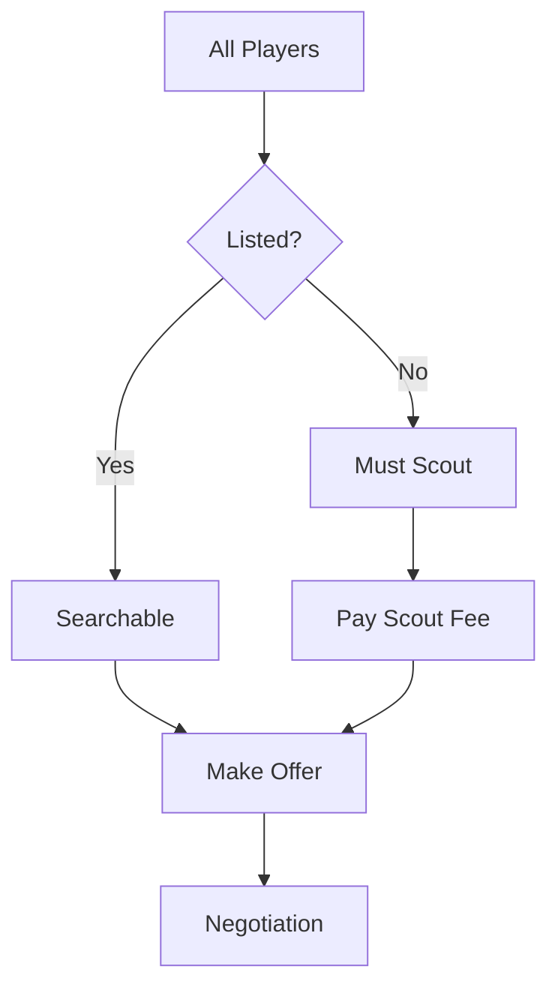
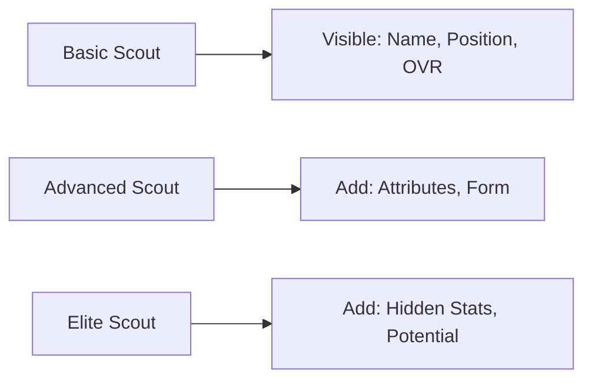

# Transfer Market

---
tags: #game-design #transfers #market #trading #mvp
status: complete
priority: high
phase: planning
last_updated: 2026-01-18
---

## Overview

The transfer market allows players to buy and sell footballers through conversational negotiations with AI-powered club representatives. It's designed to be accessible (simple offers) while offering depth (negotiation strategy).

---

## Market Structure

### Transfer Windows

| Window | Real Season | Game Time | Duration |
|--------|-------------|-----------|----------|
| Summer | Jan-Mar (Brazil) | Pre-season | 4 weeks |
| Winter | Jul (Brazil) | Mid-season | 2 weeks |
| Emergency | Anytime | Special | 1 week |

### Market Availability



---

## Player Valuation

### Base Value Formula

```typescript
function calculatePlayerValue(player: Player, context: MarketContext): number {
  // Base value from overall rating (exponential curve)
  // 85 OVR ≈ R$12.5M
  const baseValue = Math.pow(player.overall, 2.5) * 10000;
  
  // Apply modifiers
  return baseValue * 
    getAgeModifier(player.age) *
    getFormModifier(player.form) *
    getPotentialModifier(player) *
    getContractModifier(player.contractYearsLeft) *
    getPositionModifier(player.position) *
    getHypeModifier(context.mediaHype);
}
```

### Age Modifier

| Age | Modifier | Reason |
|-----|----------|--------|
| 16-20 | 0.8-1.2 | Potential premium |
| 21-23 | 1.2-1.4 | Rising star |
| 24-28 | 1.0 | Peak value |
| 29-30 | 0.85 | Slight decline |
| 31-32 | 0.70 | Clear decline |
| 33+ | 0.30-0.55 | Experience only |

### Position Scarcity

| Position | Modifier | Reason |
|----------|----------|--------|
| ST | 1.15 | Goals sell |
| WG | 1.10 | Exciting players |
| AM | 1.10 | Creativity premium |
| CM | 1.05 | Engine room |
| DM | 1.00 | Base value |
| CB | 0.95 | Defensive discount |
| FB | 0.95 | Supporting role |
| GK | 0.85 | Specialists devalued |

### Context Modifiers

| Factor | Range | When Applied |
|--------|-------|--------------|
| Recent form | 0.7-1.3 | Last 5 matches |
| Potential (youth) | 1.0-1.8 | If age < 24 |
| Contract length | 0.6-1.4 | Years remaining |
| Media hype | 0.9-1.3 | Recent mentions |
| Injury history | 0.8-1.0 | If prone |

---

## Negotiation System

### Offer Evaluation

```typescript
function evaluateOffer(
  player: Player,
  offerAmount: number,
  buyingClub: Club,
  sellingClub: Club
): OfferResponse {
  const playerValue = calculatePlayerValue(player, context);
  const offerRatio = offerAmount / playerValue;
  
  let acceptProbability = offerRatio;
  
  // Club financial situation
  if (sellingClub.budget < 1000000) {
    acceptProbability += 0.15; // Desperate to sell
  }
  if (sellingClub.budget > 50000000) {
    acceptProbability -= 0.15; // No urgency
  }
  
  // Player factors
  if (player.morale < 50) {
    acceptProbability += 0.15; // Wants out
  }
  if (player.isLegend) {
    acceptProbability -= 0.20; // Hard to sell
  }
  if (player.age > 32) {
    acceptProbability += 0.10; // Willing to move on
  }
  
  // Buyer reputation
  if (buyingClub.reputation > sellingClub.reputation) {
    acceptProbability += 0.10; // Step up for player
  }
  
  // Squad depth
  if (sellingClub.squadDepth[player.position] < 3) {
    acceptProbability -= 0.15; // Can't afford to lose
  }
  
  // Rivalry check
  if (buyingClub.isRival(sellingClub)) {
    acceptProbability -= 0.50; // Never!
  }
  
  return calculateResponse(acceptProbability, playerValue, offerAmount);
}
```

### Response Thresholds

| Probability | Response | Counter-Offer |
|-------------|----------|---------------|
| ≥ 90% | Accept | N/A |
| 70-89% | Accept with conditions | Minor add-ons |
| 40-69% | Counter-offer | 90-95% of value |
| 20-39% | Strong counter | 100-110% of value |
| < 20% | Reject | N/A |

### Negotiation Personalities

```typescript
const NEGOTIATOR_PERSONALITIES = {
  tough: {
    counterMultiplier: 1.15,  // Higher counters
    acceptThreshold: 0.95,    // Harder to please
    dialogue: [
      "That's insulting. We want R$X minimum.",
      "Don't waste our time with lowball offers.",
      "This player is worth twice that."
    ]
  },
  fair: {
    counterMultiplier: 1.05,
    acceptThreshold: 0.88,
    dialogue: [
      "We value him higher. How about R$X?",
      "That's below our valuation, but we can negotiate.",
      "Fair point. Let's meet in the middle."
    ]
  },
  friendly: {
    counterMultiplier: 0.98,
    acceptThreshold: 0.82,
    dialogue: [
      "Close! Can you do R$X?",
      "We want to make this work. R$X?",
      "I think we can find a deal here."
    ]
  }
};
```

---

## Conversational Flow

### Initiating a Transfer

```
User: "I want to buy Neymar"

AI: "Neymar is a world-class player! 🌟

📊 Player Profile:
• Overall: 91 | Position: LW
• Age: 34 | Value: R$ 45M
• Current Club: Santos

Your Budget: R$ 15M

Unfortunately, Neymar is way beyond your current budget. 
But don't worry! Here are some great alternatives in your range:

1. 👤 Bruno Henrique (84 WG) - R$ 12M
2. 👤 Raphael Veiga (83 AM) - R$ 10M  
3. 👤 Dudu (82 WG) - R$ 8M

Would you like to pursue any of these players?"
```

### Making an Offer

```
User: "Offer 10 million for Bruno Henrique"

AI: "Submitting your offer to Flamengo... 📨

🤝 NEGOTIATION WITH FLAMENGO

Flamengo's response:

'R$ 10M for Bruno Henrique? He's one of our key players 
and just scored in the derby. We'd need at least R$ 14M 
to consider this.'

Your options:
1. 💰 Increase offer (suggest amount)
2. 🤝 Meet in the middle (R$ 12M)
3. ❌ Walk away
4. 📊 Ask about payment terms

What would you like to do?"
```

### Closing the Deal

```
User: "Offer 12M"

AI: "Sending revised offer... 💼

🎉 TRANSFER AGREED!

Flamengo has accepted your offer of R$ 12M for Bruno Henrique!

📋 Transfer Details:
• Fee: R$ 12,000,000
• Contract: 3 years
• Wage: R$ 150K/week

Bruno Henrique is excited about the move:
'This is a great opportunity. I can't wait to get started!'

✅ Transfer complete! Bruno joins your squad.

💰 Remaining Budget: R$ 3M

What would you like to do next?"
```

---

## Transfer Types

### Permanent Transfer

Standard purchase with full payment.

| Aspect | Details |
|--------|---------|
| Fee | Full negotiated amount |
| Contract | 2-5 years |
| Ownership | Complete |
| Risk | Full investment |

### Loan

Temporary transfer for development or squad depth.

| Aspect | Details |
|--------|---------|
| Fee | 10-20% of value |
| Duration | 6-12 months |
| Wages | Shared or full |
| Option to Buy | Optional clause |

### Free Transfer

Players with expired contracts.

| Aspect | Details |
|--------|---------|
| Fee | R$ 0 |
| Signing Bonus | 20-50% of value |
| Competition | Multiple clubs interested |
| Timing | End of contract |

### Swap Deal

Player exchange + cash adjustment.

| Aspect | Details |
|--------|---------|
| Fee | Difference in values |
| Complexity | Two negotiations |
| Benefit | Budget efficiency |

---

## Market Intelligence

### Scouting System



| Scout Level | Cost | Information Revealed |
|-------------|------|----------------------|
| Basic | Free | Name, Position, Overall, Age |
| Standard | 500 pts | + All visible attributes |
| Advanced | 1,500 pts | + Form, Fitness, Morale |
| Elite | 5,000 pts | + Hidden attributes, Potential |

### Market Watch

```
AI: "📈 TRANSFER MARKET UPDATE

🔥 Hot Deals This Week:
• Santos is desperate for cash - all players 20% off
• Palmeiras looking to offload aging striker
• Young talent from Fluminense wants move

💡 Recommendations for your squad:
• You need a backup goalkeeper
• Your midfield could use more creativity
• Youth prospect available matching your style

Want me to scout any opportunities?"
```

---

## Deadline Day

### Special Mechanics

| Feature | Description |
|---------|-------------|
| Time Pressure | Deals must close by deadline |
| Desperate Sellers | Up to 40% discounts |
| Premium Buyers | Up to 30% markup |
| Fast Negotiations | Reduced counter-offer rounds |
| Drama | Special narrative events |

### Deadline Opportunities

```typescript
function generateDeadlineOpportunities(
  userClub: Club,
  hoursRemaining: number
): DeadlineDeal[] {
  const urgency = (24 - hoursRemaining) / 24;
  const numDeals = Math.floor(1 + urgency * 3);
  
  const deals: DeadlineDeal[] = [];
  
  for (let i = 0; i < numDeals; i++) {
    const player = findDesperate seller();
    const discount = 0.10 + urgency * 0.30; // 10-40% off
    
    deals.push({
      player,
      normalValue: calculateValue(player),
      deadlinePrice: calculateValue(player) * (1 - discount),
      expiresIn: hoursRemaining
    });
  }
  
  return deals;
}
```

---

## Squad Management

### Squad Limits

| Category | Limit | Notes |
|----------|-------|-------|
| First Team | 25 | Main squad |
| Youth | 15 | Academy players |
| Loans Out | 10 | Players on loan |
| Total | 50 | Maximum registered |

### Registration Rules

- Foreign player limit: 5 per matchday squad
- Youth quota: Minimum 3 in matchday squad
- Unregistered players can't play

### Selling Players

```
User: "Sell Gabriel"

AI: "📤 LISTING GABRIEL FOR SALE

Current Status:
• Overall: 78 | Position: CM
• Age: 26 | Contract: 2 years
• Estimated Value: R$ 4.5M

I recommend:
• Asking Price: R$ 5M (above value for negotiation room)
• Minimum: R$ 3.5M (lowest you should accept)

Set your asking price or let me recommend?"
```

---

## Related Documents

- [[02-Player-System]] - Player valuations
- [[08-Points-Rewards]] - Spending points on scouts
- [[03-Conversational-Interface]] - Negotiation UI
- [[02-Database-Schema]] - Transfer data storage

---

*"Every transfer tells two stories - the club that sells and the club that buys."*
