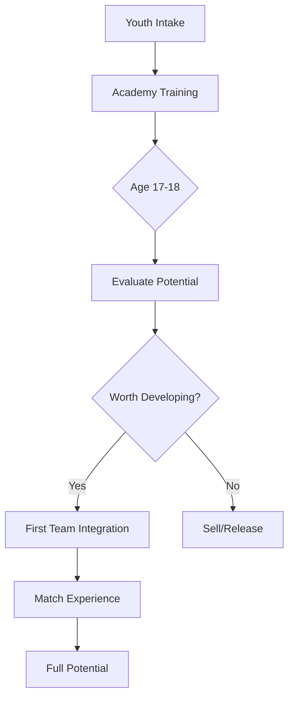
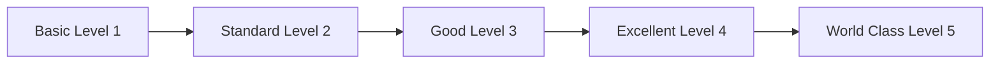

# Training & Development

---
tags: #game-design #training #development #youth #progression
status: complete
priority: high
phase: phase-2
last_updated: 2026-01-18
---

## Overview

The training system allows players to improve their squad through focused development sessions. Combined with the youth academy, it creates a satisfying long-term progression loop.

---

## Training System

### Training Types

| Type | Attributes Affected | Best For | Risk |
|------|---------------------|----------|------|
| **Technical** | DRI, PAS, SHO | Skill players | Low |
| **Physical** | PAC, PHY | Athletic roles | Medium |
| **Tactical** | PAS, DEF | Structure | Low |
| **Mental** | Consistency, BigMatch | Pressure players | Very Low |
| **Recovery** | Fitness restoration | Fatigued players | None |

### Training Effects

```typescript
const TRAINING_CONFIG = {
  technical: {
    attributes: ['dri', 'pas', 'sho'],
    baseImprovement: 0.5,    // Points per week
    injuryRisk: 0.05,        // 5% chance
    fitnessImpact: -10       // Reduces fitness
  },
  physical: {
    attributes: ['pac', 'phy'],
    baseImprovement: 0.7,
    injuryRisk: 0.10,        // Higher risk
    fitnessImpact: -15
  },
  tactical: {
    attributes: ['pas', 'def'],
    baseImprovement: 0.4,
    injuryRisk: 0.03,
    fitnessImpact: -8
  },
  mental: {
    attributes: ['consistency', 'big_match'],
    baseImprovement: 1.0,     // Hidden stats improve faster
    injuryRisk: 0.01,
    fitnessImpact: -5
  },
  recovery: {
    attributes: [],
    baseImprovement: 0,
    injuryRisk: 0,
    fitnessImpact: +30        // Restores fitness
  }
};
```

### Intensity Levels

| Intensity | Improvement | Injury Risk | Fitness Cost |
|-----------|-------------|-------------|--------------|
| Light | 0.7x | 0.5x | 0.5x |
| Normal | 1.0x | 1.0x | 1.0x |
| Intense | 1.3x | 2.0x | 1.5x |

### Age Factor

```typescript
function getAgeFactor(age: number): number {
  if (age < 21) return 1.5;      // Young players improve fast
  if (age < 24) return 1.2;
  if (age < 28) return 1.0;      // Peak
  if (age < 30) return 0.7;
  if (age < 33) return 0.4;
  return 0.2;                     // Veterans barely improve
}
```

---

## Training Flow

### Assigning Training

```
User: "Train my strikers"

AI: "⚽ TRAINING ASSIGNMENT

Available Strikers:
1. 👤 Gabriel (87) - Fitness: 85% - Good to train
2. 👤 Pedro (84) - Fitness: 70% - Needs rest
3. 👤 Yuri (79) - Fitness: 95% - Ready

Recommended Training:
📌 Technical - Shooting Focus (4 weeks)
   • Expected: +1-2 SHO for Gabriel & Yuri
   • Cost: R$ 50,000/week
   • Risk: 5% injury chance

⚠️ Pedro should do Recovery training first.

Confirm this training plan?"
```

### Training Progress

```
AI: "📊 WEEKLY TRAINING REPORT

Technical Training - Week 2/4

Progress:
• Gabriel: SHO 89 → 89.4 (+0.4) ✅
• Yuri: SHO 76 → 76.8 (+0.8) ⭐ Great progress!

Fitness Impact:
• Gabriel: 85% → 77% (train with caution)
• Yuri: 95% → 88% (still good)

💡 Tip: Yuri is responding well! Consider extending 
his training program.

Continue with current plan?"
```

### Training Completion

```
AI: "🎉 TRAINING COMPLETE!

Technical Training - Shooting Focus (4 weeks)

Final Results:
• Gabriel: SHO 89 → 90 (+1) 🌟
• Yuri: SHO 76 → 78 (+2) 🚀

Total Investment: R$ 200,000

Gabriel has reached WORLD CLASS shooting!
Yuri showed exceptional development.

What's next for your squad?"
```

---

## Youth Academy

### Academy Levels

| Level | Cost/Season | Youth Quality | Prospects/Season |
|-------|-------------|---------------|------------------|
| Basic | R$ 500K | 60-72 potential | 2-3 |
| Standard | R$ 1.5M | 68-80 potential | 3-4 |
| Advanced | R$ 3M | 75-88 potential | 4-5 |
| Elite | R$ 5M | 80-95 potential | 5-6 |

### Youth Generation

```typescript
function generateYouthProspect(academyLevel: number): YouthPlayer {
  const potentialBase = 60 + (academyLevel * 5);
  const potentialVariance = Math.random() * 15 - 5;
  const potential = Math.min(95, potentialBase + potentialVariance);
  
  const currentRating = 55 + Math.floor(Math.random() * 15);
  
  return {
    name: generateBrazilianName(),
    age: 16 + Math.floor(Math.random() * 3),
    position: randomPosition(),
    overall: currentRating,
    potential: Math.round(potential),
    developmentSpeed: 40 + Math.random() * 60,
    revealed: false  // Potential hidden until breakthrough
  };
}
```

### Youth Development Path



### Breakthrough Moments

When a youth player reaches rating 70, their potential is revealed:

```
AI: "🌟 YOUTH ACADEMY BREAKTHROUGH!

João Silva has made a breakthrough!

Before: 68 OVR (Potential: ???)
After: 70 OVR (Potential: 87!) ⭐

'João showed incredible skill in training today. 
The coaches believe he could become a star!'

He's ready for first-team consideration.
Add him to the senior squad?"
```

---

## Player Development

### Long-term Progression

| Age | Weekly Change | Notes |
|-----|---------------|-------|
| 16-18 | +0.3 to +0.6 | Rapid growth period |
| 19-21 | +0.2 to +0.4 | Continued development |
| 22-24 | +0.1 to +0.2 | Approaching peak |
| 25-29 | -0.05 to +0.05 | Stable peak years |
| 30-32 | -0.1 to 0 | Beginning decline |
| 33+ | -0.2 to -0.1 | Clear decline |

### Development Factors

```typescript
function calculateWeeklyDevelopment(player: Player): number {
  let development = getBaseAgeDevelopment(player.age);
  
  // Training bonus
  if (player.isTraining) {
    development += getTrainingBonus(player.trainingType);
  }
  
  // Match experience
  if (player.matchesLastMonth > 3) {
    development += 0.05;
  }
  
  // Morale impact
  if (player.morale > 80) {
    development *= 1.1;
  } else if (player.morale < 40) {
    development *= 0.8;
  }
  
  // Potential ceiling
  if (player.overall >= player.potential) {
    development = Math.min(0, development);
  }
  
  return development;
}
```

### Experience System

| Experience Source | Impact |
|-------------------|--------|
| First-team matches | +0.05/match |
| Goals/Assists | +0.02/goal |
| Tournament matches | +0.08/match |
| International call-ups | +0.1/call-up |
| Captain role | +0.03/month |

---

## Facilities

### Facility Types

| Facility | Cost | Effect |
|----------|------|--------|
| Training Ground | R$ 5M-50M | +10-50% training efficiency |
| Medical Center | R$ 3M-30M | -20-60% injury duration |
| Youth Academy | R$ 2M-20M | Better youth prospects |
| Recovery Center | R$ 2M-15M | +20-50% fitness recovery |
| Sports Science | R$ 5M-40M | -15-40% injury risk |

### Upgrade Path



| Level | Training Bonus | Upgrade Cost |
|-------|----------------|--------------|
| 1 | +10% | Base |
| 2 | +20% | R$ 5M |
| 3 | +30% | R$ 10M |
| 4 | +40% | R$ 20M |
| 5 | +50% | R$ 40M |

---

## Injury System

### Injury Types

| Type | Probability | Duration | Recurring Risk |
|------|-------------|----------|----------------|
| Minor | 70% | 3-14 days | 10% |
| Moderate | 20% | 14-42 days | 15% |
| Serious | 8% | 42-90 days | 25% |
| Critical | 2% | 90-270 days | 40% |

### Injury Prevention

```typescript
function calculateInjuryRisk(player: Player): number {
  let risk = 0.02; // Base 2%
  
  // Fitness impact
  if (player.fitness < 50) risk *= 3;
  else if (player.fitness < 70) risk *= 1.5;
  
  // Training intensity
  if (player.trainingIntensity === 'intense') risk *= 2;
  
  // Injury prone attribute
  risk *= (1 + player.injuryProne / 200);
  
  // Facilities reduction
  risk *= (1 - facilityBonus);
  
  // Match congestion
  if (player.matchesLast14Days > 4) risk *= 1.5;
  
  return risk;
}
```

### Recovery

```
AI: "🏥 INJURY UPDATE

Bruno Henrique suffered a hamstring strain in training.

Diagnosis: Moderate injury
Expected Return: 3-4 weeks
Current Fitness: 45%

Recovery Plan:
• Week 1-2: Medical treatment (R$ 50K)
• Week 3: Light training
• Week 4: Match fitness training

Estimated full recovery: March 15

Want to invest in accelerated recovery? (+R$ 100K, -1 week)"
```

---

## Training Schedule

### Weekly Structure

| Day | Activity | Notes |
|-----|----------|-------|
| Monday | Training | Focus session |
| Tuesday | Training | Intensity varies |
| Wednesday | Match or Rest | Depends on schedule |
| Thursday | Recovery/Light | Pre-match if needed |
| Friday | Tactical | Match preparation |
| Saturday | Match Day | Most common |
| Sunday | Rest | Recovery priority |

### Match Week Adjustments

```typescript
function adjustTrainingForMatchWeek(
  matchDay: number,
  normalTraining: TrainingPlan
): TrainingPlan {
  // Day before match: Light training only
  if (daysUntilMatch === 1) {
    return { type: 'recovery', intensity: 'light' };
  }
  
  // Match day: No training
  if (daysUntilMatch === 0) {
    return null;
  }
  
  // Two days before: Tactical focus
  if (daysUntilMatch === 2) {
    return { type: 'tactical', intensity: 'light' };
  }
  
  return normalTraining;
}
```

---

## Related Documents

- [[02-Player-System]] - Player attributes
- [[01-Gameplay-Loop]] - Development in game loop
- [[08-Points-Rewards]] - Training costs
- [[02-Database-Schema]] - Training data storage

---

*"Champions are made in training, not just in matches."*
