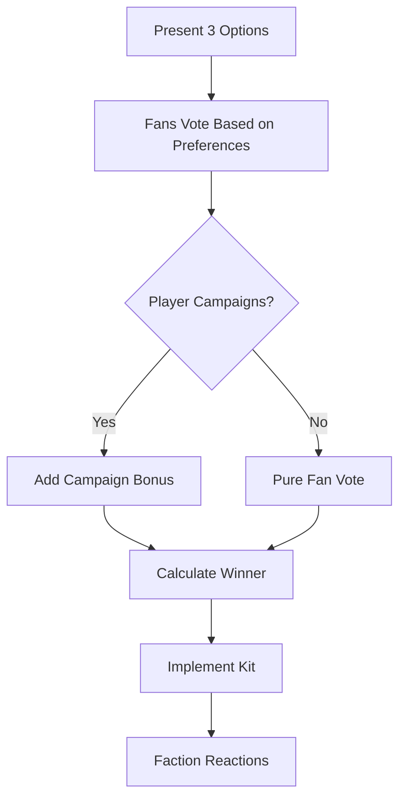

# Virtual Fanbase

---
tags: #game-design #fans #factions #mood #engagement
status: complete
priority: high
phase: phase-2
last_updated: 2026-01-18
---

## Overview

The virtual fanbase system adds unpredictability and emotional depth to the game. AI-controlled fan factions react to player decisions, affecting team performance, revenue, and narrative drama.

> [!tip] Core Concept
> Fans aren't just background - they're stakeholders with opinions, demands, and the power to influence your club's success.

---

## Fan Factions

Four distinct fan groups with different priorities and behaviors:

### Traditionalists (30%)

```yaml
Profile:
  Priority: Club history, identity, local players
  Volatility: Low (40/100) - Slow to change opinion
  Influence: High (80/100) - Respected voice
  
Loves:
  - Classic kit designs
  - Youth academy graduates
  - Conservative spending
  - Club legends honored
  
Hates:
  - Radical changes
  - Selling icons to rivals
  - Foreign takeovers
  - Modernist experiments
```

### Modernists (25%)

```yaml
Profile:
  Priority: Innovation, global brand, modern tactics
  Volatility: Medium (60/100)
  Influence: Medium-High (70/100)
  
Loves:
  - Star signings
  - Stadium upgrades
  - Modern marketing
  - Tactical innovation
  
Hates:
  - Outdated approaches
  - Missed opportunities
  - Risk aversion
  - Ignoring trends
```

### Ultras (20%)

```yaml
Profile:
  Priority: Passion, attacking football, rivalry victories
  Volatility: Very High (90/100) - Extremely reactive
  Influence: Very High (85/100) - Loudest voice
  
Loves:
  - Derby victories
  - Attacking football
  - Loyal players
  - Visible passion
  
Hates:
  - Defensive tactics
  - Selling to rivals
  - Corporate decisions
  - Losing derbies
```

### Casuals (25%)

```yaml
Profile:
  Priority: Winning, entertainment, star players
  Volatility: High (70/100)
  Influence: Low (50/100) - Quieter voice
  
Loves:
  - Winning streaks
  - Famous players
  - Social media buzz
  - Entertainment value
  
Hates:
  - Losing runs
  - Boring football
  - No star players
  - Negative press
```

---

## Mood System

### Mood Calculation

```typescript
function calculateFactionMood(
  faction: FanFaction,
  clubState: ClubState,
  recentEvents: GameEvent[]
): number {
  let mood = 50; // Neutral baseline
  
  // Recent results (last 5 matches)
  const wins = clubState.lastFiveResults.filter(r => r === 'W').length;
  mood += (wins - 2.5) * 8; // ±20 points based on form
  
  // League position
  if (clubState.leaguePosition <= 4) mood += 10;
  if (clubState.leaguePosition >= 15) mood -= 15;
  
  // Faction-specific factors
  mood += getFactionSpecificMood(faction, clubState, recentEvents);
  
  // Apply volatility (stable factions resist change)
  const stability = 100 - faction.volatility;
  mood = (mood * faction.volatility + 50 * stability) / 100;
  
  return Math.max(0, Math.min(100, mood));
}
```

### Faction-Specific Factors

| Faction | Positive Triggers | Negative Triggers |
|---------|-------------------|-------------------|
| Traditionalists | Youth debut (+5), Classic kit (+10) | Legend sold (-15), Radical change (-10) |
| Modernists | Star signing (+15), Stadium upgrade (+10) | Missed target (-10), Old tactics (-5) |
| Ultras | Derby win (+20), Attacking style (+10) | Derby loss (-25), Defensive play (-10) |
| Casuals | Win streak (+10), Viral moment (+8) | Losing streak (-15), Boring match (-5) |

### Overall Fan Mood

```typescript
function calculateOverallMood(factionMoods: FactionMood[]): number {
  let totalMood = 0;
  let totalInfluence = 0;
  
  for (const fm of factionMoods) {
    totalMood += fm.mood * fm.faction.influence;
    totalInfluence += fm.faction.influence;
  }
  
  return totalMood / totalInfluence;
}
```

---

## Fan Impact

### Match Performance

```typescript
function getFanMoodMatchBonus(fanMood: number, isHome: boolean): MatchModifier {
  if (!isHome) return { performance: 1.0, atmosphere: 'neutral' };
  
  if (fanMood >= 90) {
    return {
      performance: 1.15,
      atmosphere: 'euphoric',
      description: '🔥 The crowd is incredible! 12th man effect!'
    };
  } else if (fanMood >= 70) {
    return {
      performance: 1.05,
      atmosphere: 'supportive',
      description: 'Strong support from the stands.'
    };
  } else if (fanMood >= 50) {
    return {
      performance: 1.00,
      atmosphere: 'neutral',
      description: 'Normal atmosphere today.'
    };
  } else if (fanMood >= 30) {
    return {
      performance: 0.95,
      atmosphere: 'tense',
      description: '😟 Fans are restless. Pressure on the team.'
    };
  } else {
    return {
      performance: 0.85,
      atmosphere: 'hostile',
      description: '😠 Boos and whistles. Team looks nervous.'
    };
  }
}
```

### Revenue Impact

| Fan Mood | Attendance | Merchandise | Sponsorship |
|----------|------------|-------------|-------------|
| 90+ | +30% | +40% | +20% |
| 70-89 | +10% | +15% | +10% |
| 50-69 | Base | Base | Base |
| 30-49 | -15% | -20% | -10% |
| <30 | -40% | -50% | -25% |

### Narrative Events

```
High Mood (90+):
"The fans are organizing a TIFO display for the next match! 
They want to show their appreciation for the team's success."

Low Mood (<30):
"Supporter groups are planning a protest before the next match.
They're demanding changes from the management."
```

---

## Fan Voting

### Kit Design Vote



### Vote Mechanics

```typescript
function simulateKitVote(
  options: KitDesign[],
  factionMoods: FactionMood[],
  playerCampaign?: Campaign
): VoteResult {
  const votes = { option1: 0, option2: 0, option3: 0 };
  
  for (const faction of Object.values(FAN_FACTIONS)) {
    const factionVotes = faction.percentage;
    
    // Score each option for this faction
    const scores = options.map(kit => scoreKitForFaction(kit, faction));
    
    // Add randomness
    scores.forEach((s, i) => scores[i] *= (0.8 + Math.random() * 0.4));
    
    // Distribute votes proportionally
    const total = scores.reduce((a, b) => a + b, 0);
    options.forEach((_, i) => {
      votes[`option${i+1}`] += (scores[i] / total) * factionVotes;
    });
  }
  
  // Apply player campaign
  if (playerCampaign) {
    const boost = Math.min(playerCampaign.pointsSpent / 100, 15);
    votes[`option${playerCampaign.choice}`] += boost;
  }
  
  return normalizeVotes(votes);
}
```

### Votable Decisions

| Decision | Frequency | Impact |
|----------|-----------|--------|
| Kit Design | Annual | Visual identity |
| Stadium Name | One-time | Sponsorship vs tradition |
| Charity Partner | Annual | Community relations |
| Friendly Opponent | Pre-season | Prestige vs revenue |
| Captain Choice | When needed | Leadership |
| Goal Celebration | Ongoing | Entertainment |

---

## Fan Events

### Positive Events

```
DERBY DAY ATMOSPHERE
"Ultras have organized a massive display for tomorrow's derby!
The atmosphere will be electric. +20% home bonus expected."

VIRAL FAN MOMENT  
"A young fan's celebration video went viral!
2 million views and counting. Casual fans are delighted. +10 mood."

LEGEND HOMECOMING
"Club legend returns for testimonial match!
Traditionalists are thrilled. +15 mood for traditionalist faction."
```

### Negative Events

```
FAN PROTEST PLANNED
"Supporter groups announce protest before next match.
Team morale at risk. Fan mood critically low."

SOCIAL MEDIA BACKLASH
"Controversial decision sparks online outrage.
Casuals and Modernists upset. -10 mood across factions."

DERBY DEFEAT FALLOUT
"After losing the derby, Ultras demand manager dismissal.
Tension in the fanbase. -25 mood for Ultras."
```

### Dynamic Triggers

```typescript
const FAN_EVENT_TRIGGERS = {
  derbyWin: {
    probability: 0.8,
    event: 'ULTRA_CELEBRATION',
    moodImpact: { ultras: +20, all: +10 }
  },
  derbyLoss: {
    probability: 0.9,
    event: 'ULTRA_ANGER',
    moodImpact: { ultras: -25, all: -10 }
  },
  winStreak5: {
    probability: 0.7,
    event: 'MOMENTUM_CELEBRATION',
    moodImpact: { all: +15 }
  },
  loseStreak3: {
    probability: 0.8,
    event: 'CONCERN_GROWING',
    moodImpact: { all: -15 }
  },
  legendSold: {
    probability: 1.0,
    event: 'TRADITIONALIST_ANGER',
    moodImpact: { traditionalists: -20, ultras: -15 }
  }
};
```

---

## Player Influence

### Spending Points on Fans

| Action | Cost | Effect |
|--------|------|--------|
| Campaign for Vote | 300-800 pts | +10-15% influence on vote |
| Appease Faction | 500 pts | +10 mood for one faction |
| Press Conference | Free | Explain decisions, ±5 mood |
| Community Event | 1000 pts | +5 mood all factions |
| Derby Hype | 500 pts | +10% Ultras mood |

### Communication Options

```
AI: "The Traditionalists are upset about selling João to our rivals.
Current mood: 45% 😠

You can:
1. 🎤 Hold press conference (explain the sale)
2. 💰 Announce youth investment (500 pts)
3. 🤝 Promise to never sell to rivals again
4. 🤷 Ignore them (risk further decline)

What would you like to do?"
```

---

## Long-term Dynamics

### Faction Balance Shifts

Over time, faction sizes can shift based on club trajectory:

| Club Direction | Faction Shift |
|----------------|---------------|
| Sustained success | Casuals grow (+5%) |
| Attacking identity | Ultras grow (+3%) |
| Youth investment | Traditionalists grow (+3%) |
| Modernization | Modernists grow (+4%) |
| Decline | All shrink, Ultras grow |

### Generational Change

```typescript
// Each season, slight faction evolution
function evolveFactionsizes(clubHistory: ClubHistory): void {
  // Young fans join based on recent success
  if (clubHistory.trophiesLast5Years > 2) {
    FACTIONS.casuals.percentage += 1;
  }
  
  // Tradition builds over time
  if (clubHistory.yearsOfHistory > 50) {
    FACTIONS.traditionalists.percentage += 0.5;
  }
  
  // Normalize to 100%
  normalizePercentages();
}
```

---

## Related Documents

- [[03-Match-Simulation]] - Fan impact on matches
- [[02-Onboarding-Flow]] - Fan introduction

---

*"In football, fans aren't spectators - they're the soul of the club."*
