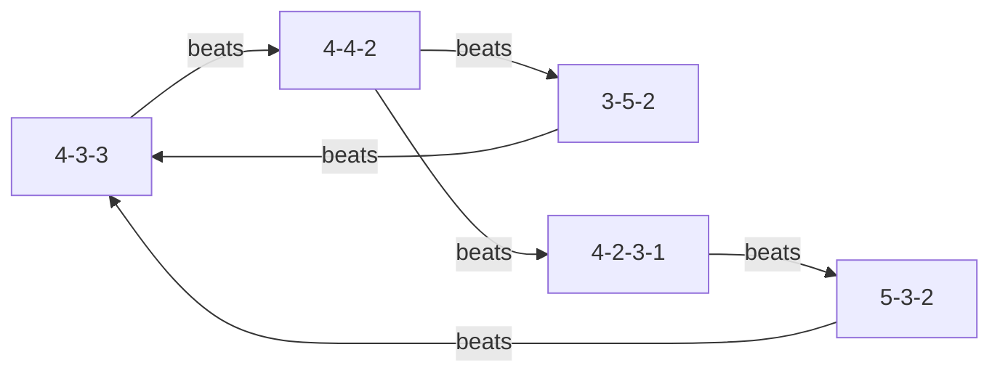

# Formations & Tactics

---
tags: #game-design #formations #tactics #strategy #mvp
status: complete
priority: high
phase: planning
last_updated: 2026-01-18
---

## Overview

The tactical system gives players meaningful strategic choices without overwhelming complexity. Each formation and tactical setting has clear trade-offs.

---

## Available Formations

### Attacking Formations

#### 4-3-3 (Default)

```
        ST
    LW      RW
      CM CM
        DM
    LB CB CB RB
        GK
```

| Aspect | Value |
|--------|-------|
| Style | Attacking, Wide play |
| Attack Modifier | 1.10 |
| Midfield Modifier | 1.00 |
| Defense Modifier | 0.95 |
| Best Against | Narrow formations (4-4-2, 5-3-2) |
| Weak Against | Midfield-heavy (3-5-2, 4-2-3-1) |

#### 4-2-3-1 (Modern)

```
        ST
    LM  AM  RM
      DM  DM
    LB CB CB RB
        GK
```

| Aspect | Value |
|--------|-------|
| Style | Flexible, Possession |
| Attack Modifier | 1.05 |
| Midfield Modifier | 1.10 |
| Defense Modifier | 1.00 |
| Best Against | Traditional formations |
| Weak Against | Counter-attacking teams |

### Balanced Formations

#### 4-4-2 (Classic)

```
      ST  ST
    LM  CM CM  RM
    LB CB CB RB
        GK
```

| Aspect | Value |
|--------|-------|
| Style | Balanced, Direct |
| Attack Modifier | 1.00 |
| Midfield Modifier | 1.05 |
| Defense Modifier | 1.00 |
| Best Against | 3-back systems |
| Weak Against | Wide formations (4-3-3) |

#### 3-5-2 (Possession)

```
      ST  ST
    LM CM CM CM RM
      CB  CB  CB
        GK
```

| Aspect | Value |
|--------|-------|
| Style | Midfield dominance |
| Attack Modifier | 0.95 |
| Midfield Modifier | 1.15 |
| Defense Modifier | 0.95 |
| Best Against | 4-3-3, 4-4-2 |
| Weak Against | Wing-focused attacks |

### Defensive Formations

#### 5-3-2 (Defensive)

```
      ST  ST
      CM CM CM
    LWB CB CB CB RWB
        GK
```

| Aspect | Value |
|--------|-------|
| Style | Solid, Counter-attacking |
| Attack Modifier | 0.85 |
| Midfield Modifier | 0.95 |
| Defense Modifier | 1.20 |
| Best Against | Attacking formations |
| Weak Against | Possession teams |

#### 4-5-1 (Ultra Defensive)

```
          ST
    LM CM CM CM RM
    LB CB CB RB
        GK
```

| Aspect | Value |
|--------|-------|
| Style | Packed midfield, Counter |
| Attack Modifier | 0.80 |
| Midfield Modifier | 1.20 |
| Defense Modifier | 1.10 |
| Best Against | Aggressive teams |
| Weak Against | Patient build-up |

---

## Formation Matchups

### Advantage Matrix

```typescript
const MATCHUP_MATRIX = {
  '4-3-3': {
    strongVs: ['4-4-2', '5-3-2'],      // +5% advantage
    neutralVs: ['4-3-3', '4-5-1'],
    weakVs: ['3-5-2', '4-2-3-1']       // -5% disadvantage
  },
  '4-4-2': {
    strongVs: ['3-5-2', '4-2-3-1'],
    neutralVs: ['4-4-2', '5-3-2'],
    weakVs: ['4-3-3', '4-5-1']
  },
  '3-5-2': {
    strongVs: ['4-3-3', '4-4-2'],
    neutralVs: ['3-5-2', '4-2-3-1'],
    weakVs: ['5-3-2', '4-5-1']
  },
  '5-3-2': {
    strongVs: ['4-3-3', '3-5-2'],
    neutralVs: ['4-4-2', '5-3-2'],
    weakVs: ['4-2-3-1', '4-5-1']
  },
  '4-2-3-1': {
    strongVs: ['4-3-3', '5-3-2'],
    neutralVs: ['4-2-3-1', '4-5-1'],
    weakVs: ['4-4-2', '3-5-2']
  },
  '4-5-1': {
    strongVs: ['4-3-3', '4-4-2'],
    neutralVs: ['4-2-3-1', '4-5-1'],
    weakVs: ['3-5-2', '5-3-2']
  }
};
```

### Counter System Visual



---

## Tactical Settings

### Mentality

| Setting | Attack | Defense | Description |
|---------|--------|---------|-------------|
| Defensive | 0.85x | 1.15x | Prioritize not conceding |
| Balanced | 1.00x | 1.00x | Equal focus |
| Attacking | 1.15x | 0.90x | Push for goals |
| All-Out Attack | 1.25x | 0.80x | Desperate push |

### Pressing

| Setting | Midfield | Defense | Risk |
|---------|----------|---------|------|
| Low Block | 0.90x | 1.10x | Safe, less possession |
| Medium Press | 1.00x | 1.00x | Balanced |
| High Press | 1.10x | 0.95x | Win ball high, gaps behind |
| Gegenpressing | 1.20x | 0.85x | Intense, tiring |

### Width

| Setting | Effect | Best For |
|---------|--------|----------|
| Narrow | Compact, central play | Possession teams |
| Normal | Balanced width | All-around |
| Wide | Stretch opposition | Wing-focused attacks |

### Tempo

| Setting | Effect | Trade-off |
|---------|--------|-----------|
| Slow | Patient build-up | Can be predictable |
| Normal | Varied pace | Balanced |
| Fast | Quick transitions | Less control |
| Counter | Sit deep, break fast | Need pace |

---

## Tactical Interface

### Setting Tactics (Conversation)

```
User: "Play more defensively"

AI: "🛡️ TACTICAL ADJUSTMENT

Switching to Defensive mentality:
• Attack power: 85% (was 100%)
• Defense power: 115% (was 100%)

Your team will:
✅ Sit deeper and protect the lead
✅ Focus on counter-attacks
❌ Create fewer chances
❌ Less possession expected

Formation remains 4-3-3. Confirm this change?"
```

### Formation Change

```
User: "Change to 5-3-2"

AI: "📋 FORMATION CHANGE: 5-3-2

New lineup:
        Gabigol  Pedro
      Everton  Gerson  Arrascaeta
    Filipe  Léo  Fabrício  Gustavo  Rodinei
              Hugo

Analysis:
✅ Stronger defensively (+20%)
✅ Good against 4-3-3 opponents
❌ Less attacking threat (-15%)
❌ Wingers playing as wing-backs

This matches well against tomorrow's opponent (4-3-3).
Confirm formation?"
```

### Pre-Match Tactics

```
AI: "⚽ PRE-MATCH TACTICAL BRIEFING

Tomorrow: Flamengo vs Palmeiras (Away)

Opponent Analysis:
• Palmeiras plays 4-2-3-1
• Strong midfield presence
• Vulnerable to width

Recommended Tactics:
📌 Formation: 4-3-3 (counter their midfield)
📌 Mentality: Balanced (respect away difficulty)
📌 Pressing: Medium (conserve energy)
📌 Width: Wide (exploit their fullbacks)

Expected Match Rating: ⭐⭐⭐ (Balanced matchup)

Accept these recommendations or customize?"
```

---

## In-Match Tactics

### Substitutions

```typescript
const SUBSTITUTION_EFFECTS = {
  fresh_legs: {
    fitnessBoost: 30,
    performanceBoost: 0.05,
    description: "Fresh player with more energy"
  },
  tactical_change: {
    formationImpact: true,
    performanceBoost: 0.03,
    description: "Changes team shape"
  },
  defensive_sub: {
    defenseBoost: 0.08,
    attackPenalty: -0.05,
    description: "Protecting a lead"
  },
  attacking_sub: {
    attackBoost: 0.10,
    defensePenalty: -0.08,
    description: "Chasing the game"
  }
};
```

### Tactical Adjustments During Match

```
AI: "⏱️ 65' - You're trailing 1-0

Options:
1. 🔄 Attacking substitution (bring on striker)
2. ⬆️ Switch to Attacking mentality
3. 📐 Change to 4-3-3 (more width)
4. ⚡ Go All-Out Attack (high risk)
5. 🤝 Keep current tactics

Your fans are getting restless...
What would you like to do?"
```

### Time-Based Modifiers

| Situation | Trailing Team | Leading Team |
|-----------|---------------|--------------|
| After 75' | +5% attack boost | +5% defense |
| After 85' | +10% attack | +10% defense |
| Injury time | +15% attack | Defending deep |

---

## Tactical Depth (Advanced)

### Player Instructions

| Instruction | Effect | Available For |
|-------------|--------|---------------|
| Stay Back | +10% defense | Fullbacks, DM |
| Get Forward | +10% attack | Fullbacks, CM |
| Cut Inside | More central play | Wingers |
| Stay Wide | Stretch defense | Wingers |
| Target Man | Receive long balls | Strikers |
| False 9 | Drop deep | Strikers |

### Set Pieces

| Set Piece | Options |
|-----------|---------|
| Corners | Near post, far post, short |
| Free Kicks | Direct, crossed, played short |
| Penalties | Designated takers (1-3) |
| Throw-ins | Quick, long throw |

### Counter-Tactics

The AI opponent adapts to player patterns:

```typescript
function aiTacticalResponse(
  opponentPattern: Pattern,
  currentScore: Score,
  minute: number
): TacticalAdjustment {
  // If player always attacks, AI goes defensive
  if (opponentPattern.mentality === 'attacking') {
    return { mentality: 'counter', pressing: 'low' };
  }
  
  // If player dominates possession, AI presses high
  if (opponentPattern.possession > 60) {
    return { pressing: 'high' };
  }
  
  // If losing late, AI attacks
  if (currentScore.behind && minute > 75) {
    return { mentality: 'attacking' };
  }
  
  return null; // No change
}
```

---

## Learning Curve

### Beginner

- Just pick formation
- AI suggests tactics
- Simple mentality choices

### Intermediate

- Understand matchups
- Adjust pressing/width
- Make in-match changes

### Advanced

- Player instructions
- Counter-tactical thinking
- Set piece mastery
- Adaptive strategies

---

## Related Documents

- [[03-Match-Simulation]] - How tactics affect matches
- [[02-Player-System]] - Player roles in formations
- [[01-Gameplay-Loop]] - Tactical decisions in game loop
- [[04-AI-LLM-Strategy]] - AI opponent tactics

---

*"Tactics win matches. But the best tactic is the one your players can execute."*
