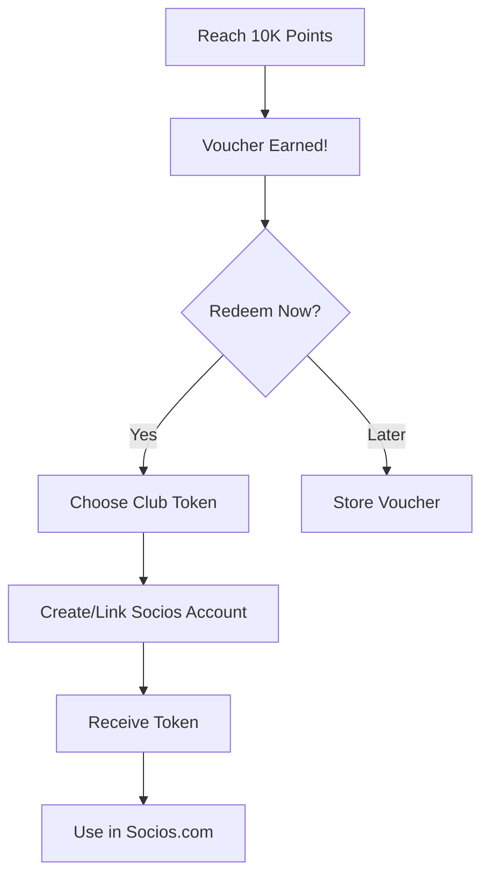

# Points & Rewards Economy

---
tags: #game-design #economy #points #rewards #tokens #mvp
status: complete
priority: critical
phase: planning
last_updated: 2026-01-18
---

## Overview

The points economy is the bridge between gameplay and real-world value. Players earn Socios Points through gameplay and can convert them to actual Fan Token vouchers.

> [!important] Core Balance
> Casual players reach first voucher in ~40-60 hours. Active players in ~25-35 hours. This feels achievable without being too easy.

---

## Points System

### Earning Points

#### Daily Activities

| Activity | Points | Frequency | Notes |
|----------|--------|-----------|-------|
| Daily Login | 10 | Once/day | Base reward |
| 3-Day Streak | 30 | Every 3 days | Bonus |
| 7-Day Streak | 100 | Weekly | Major bonus |
| 30-Day Streak | 1,000 | Monthly | Huge bonus |

#### Match Results

| Result | Base Points | Notes |
|--------|-------------|-------|
| Win (Easy) | 50 | Weaker opponent |
| Win (Normal) | 75 | Equal opponent |
| Win (Hard) | 100 | Stronger opponent |
| Win (Very Hard) | 150 | Much stronger |
| Draw | 25 | Any opponent |
| Loss | 0 | No penalty |

#### Performance Bonuses

| Achievement | Points | Trigger |
|-------------|--------|---------|
| Clean Sheet | 25 | No goals conceded |
| Hat-trick | 50 | Player scores 3+ |
| Comeback Win | 50 | Win after trailing |
| Dominant Win | 40 | Win by 3+ goals |
| Derby Win | 50 | Beat rival team |
| Late Drama | 30 | Win in 85'+ |

#### Streaks

| Streak | Points | Trigger |
|--------|--------|---------|
| 3 Win Streak | 100 | 3 consecutive wins |
| 5 Win Streak | 250 | 5 consecutive wins |
| 10 Win Streak | 1,000 | 10 consecutive wins |
| 10 Unbeaten | 500 | 10 without loss |

#### Season Milestones

| Achievement | Points | Description |
|-------------|--------|-------------|
| Season Complete | 1,000 | Finish the season |
| Top Half Finish | 1,500 | 10th or better |
| Top 4 Finish | 2,500 | Champions League spots |
| Promotion | 3,000 | Move up a division |
| League Title | 5,000 | Win the league |
| Unbeaten Season | 10,000 | No losses all season |

#### Cup Competitions

| Stage | Points |
|-------|--------|
| Quarter-final | 300 |
| Semi-final | 700 |
| Final Appearance | 1,500 |
| Cup Winner | 3,000 |

#### Other Activities

| Activity | Points | Notes |
|----------|--------|-------|
| Youth Graduate Debut | 100 | Academy player plays |
| Player Reaches 80 OVR | 300 | Development success |
| Player Reaches 90 OVR | 500 | Star creation |
| Profit Transfer | Varies | 1 pt per R$100K profit |
| Fan Vote Participation | 20 | Engage with fans |
| Friend Referral (Join) | 500 | Successful invite |

---

## Token Conversion

### Voucher System

```
10,000 Socios Points = 1 Fan Token Voucher
```

### Earning Rates

| Player Type | Points/Hour | Time to Voucher |
|-------------|-------------|-----------------|
| Casual | 150-200 | 50-67 hours |
| Regular | 250-350 | 29-40 hours |
| Hardcore | 400-500 | 20-25 hours |

### Premium Multiplier

Premium subscribers earn **2x points** on all activities.

| Player Type | Premium Points/Hour | Time to Voucher |
|-------------|---------------------|-----------------|
| Casual | 300-400 | 25-33 hours |
| Regular | 500-700 | 14-20 hours |
| Hardcore | 800-1000 | 10-12.5 hours |

---

## Spending Points

### Training & Development

| Expense | Cost | Effect |
|---------|------|--------|
| Basic Scout Report | 500 | Reveal player basics |
| Advanced Scout | 1,500 | Reveal all attributes |
| Elite Scout | 5,000 | Reveal hidden potential |
| Training Boost | 1,000 | +50% training week |
| Youth Academy Upgrade | 10,000 | Better prospects |

### Fan Engagement

| Expense | Cost | Effect |
|---------|------|--------|
| Campaign for Vote | 300-800 | +10-15% vote influence |
| Appease Faction | 500 | +10 mood one faction |
| Community Event | 1,000 | +5 mood all factions |

### Premium Items

| Item | Cost | Effect |
|------|------|--------|
| Extra Squad Slot | 2,000 | +1 roster spot |
| Manager Costume | 500 | Cosmetic |
| Stadium Theme | 1,500 | Visual customization |
| Name Change | 1,000 | Once per season |

---

## Economy Balance

### Daily Earning Potential

```typescript
const DAILY_POTENTIAL = {
  minimum: {
    login: 10,
    matches: 75,    // 1 match
    total: 85
  },
  casual: {
    login: 10,
    streak: 10,     // Average
    matches: 200,   // 2-3 matches
    bonuses: 30,
    total: 250
  },
  active: {
    login: 10,
    streak: 15,
    matches: 400,   // 4-5 matches
    bonuses: 75,
    achievements: 100,
    total: 600
  },
  hardcore: {
    login: 10,
    streak: 30,
    matches: 600,   // 6-8 matches
    bonuses: 150,
    achievements: 200,
    tournaments: 200,
    total: 1190
  }
};
```

### Weekly Caps

To prevent exploitation and maintain economy health:

| Cap Type | Limit | Reset |
|----------|-------|-------|
| Daily Points | 2,000 | Midnight |
| Daily Matches | 50 | Midnight |
| Weekly Bonus Points | 5,000 | Sunday |

### Monthly Projection

| Player Type | Monthly Points | Vouchers/Month |
|-------------|----------------|----------------|
| Casual (5hr/week) | 3,000-4,000 | 0.3-0.4 |
| Regular (10hr/week) | 8,000-12,000 | 0.8-1.2 |
| Hardcore (20hr/week) | 20,000-30,000 | 2-3 |

---

## Anti-Abuse Mechanisms

### Rate Limiting

```typescript
const ANTI_ABUSE = {
  // Daily limits
  dailyMaxPoints: 2000,
  dailyMaxMatches: 50,
  
  // Cooldowns
  sameOpponentCooldown: 3600,  // 1 hour
  referralCooldown: 86400,     // 24 hours
  
  // Rate limits
  actionsPerMinute: 30,
  pointsPerMinuteMax: 100
};
```

### Fraud Detection

```typescript
const SUSPICIOUS_PATTERNS = [
  'win_rate_over_95_percent',      // Impossible consistency
  'identical_match_results',        // Bot behavior
  'rapid_account_creation',         // Multi-accounting
  'immediate_voucher_redemption',   // Automated farming
  'inhuman_reaction_times',         // Script detection
  'same_ip_multiple_accounts'       // IP tracking
];

function checkForAbuse(user: User, action: Action): AbuseCheck {
  if (user.todayPoints >= DAILY_MAX) {
    return { allowed: false, reason: 'daily_cap' };
  }
  
  if (user.winRate > 0.95 && user.matches > 100) {
    return { allowed: true, flagForReview: true };
  }
  
  const recentActions = user.getActionsInWindow(60);
  if (recentActions.length > 30) {
    return { allowed: false, reason: 'rate_limit' };
  }
  
  return { allowed: true };
}
```

### Behavioral Flags

| Flag | Trigger | Action |
|------|---------|--------|
| Suspicious Win Rate | >95% over 100 matches | Manual review |
| Rapid Progression | 10K points in 24h | Verification |
| Multiple Accounts | Same device/IP | Warning, then ban |
| Bot Behavior | Pattern detection | Immediate suspension |

---

## Voucher Redemption

### The Redemption Flow



### Redemption Message

```
AI: "🎉 CONGRATULATIONS!

You've earned 10,000 Socios Points!

You've unlocked: 1 FAN TOKEN VOUCHER 🎟️

This voucher can be redeemed for a REAL fan token 
from any supported club!

Popular choices:
⚫🔴 Flamengo ($MENGO)
⚪⚫ Corinthians ($SCCP)
🔵⚪ Barcelona ($BAR)
⚪ Real Madrid (coming soon)

[Redeem Now] [Learn More] [Save for Later]

No pressure - vouchers never expire!"
```

---

## Premium Benefits

### Season Pass ($4.99/month)

| Benefit | Description |
|---------|-------------|
| 2x Points | Double earning on all activities |
| No Ads | Remove all advertisements |
| Exclusive Formations | 3 premium formations |
| Extra Saves | 3 save slots (vs 1) |
| Premium Badge | Visible profile flair |
| Early Access | New features first |
| Weekly Bonus | 500 bonus points/week |

### Value Proposition

```
Without Premium: ~40 hours to first voucher
With Premium: ~20 hours to first voucher

$4.99/month = faster progression + better experience
Token value: $5-10+ each

Break-even: Earn 1 extra voucher/month = positive ROI
```

---

## Economy Metrics

### Health Indicators

| Metric | Healthy Range | Action if Outside |
|--------|---------------|-------------------|
| Avg Daily Earn | 150-400 pts | Adjust rewards |
| Time to Voucher | 30-60 hours | Rebalance |
| Premium Conversion | 8-15% | Adjust benefits |
| Voucher Redemption | 60-80% | Improve flow |
| Economy Inflation | <5%/month | Cap adjustments |

### Tracking Dashboard

```typescript
interface EconomyMetrics {
  totalPointsIssued: number;
  totalPointsSpent: number;
  totalVouchersEarned: number;
  totalVouchersRedeemed: number;
  avgTimeToFirstVoucher: number;
  premiumConversionRate: number;
  dailyActiveEarners: number;
  topEarnersCapped: number;  // Hit daily limit
}
```

---

## Related Documents

- [[00-Monetization]] - Revenue model
- [[01-Fan-Token-Integration]] - Token system details
- [[01-Gameplay-Loop]] - Earning in game loop
- [[02-Analytics-Clustering]] - Player segmentation

---

*"Rewards should feel earned, not bought. Progress should feel achievable, not endless."*
