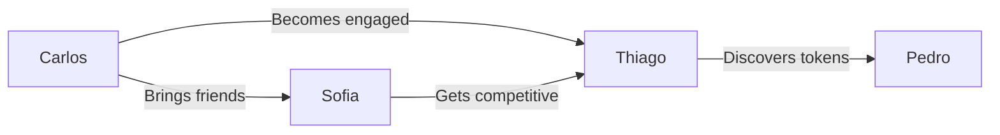

# User Personas

---
tags: #ux #personas #users #research
status: complete
priority: high
phase: planning
last_updated: 2026-01-18
---

## Overview

Four primary personas represent our target audience. Each has distinct motivations, behaviors, and needs that inform our design decisions.

---

## Persona 1: Casual Carlos (40%)

> "I love football, but I don't have hours to spend on games."

### Profile

```yaml
Demographics:
  Age: 18-28
  Occupation: Student or early career
  Income: Low to moderate
  Location: São Paulo, Rio de Janeiro metro
  
Devices:
  Primary: Android smartphone (mid-range)
  Secondary: Shared family computer
  
Football Engagement:
  Team: Has one passionate team allegiance
  Watches: Weekend matches, highlights on social
  Games: Casual mobile games, FIFA occasionally
```

### Behavior Patterns

| Pattern | Description |
|---------|-------------|
| Session Length | 5-15 minutes |
| Session Frequency | 1-2x daily |
| Peak Times | Commute, lunch break, before bed |
| Spending | Free-to-play, occasional small purchase |
| Social | Shares wins on WhatsApp groups |

### Goals

- Quick entertainment during downtime
- Feel connected to favorite team
- Compete casually with friends
- Earn rewards without grinding

### Pain Points

- Limited time for complex games
- Limited budget for gaming
- Overwhelmed by complicated UIs
- Skeptical of crypto/tokens

### How We Serve Carlos

| Need | Solution |
|------|----------|
| Quick sessions | 5-minute matches |
| Simple UI | Conversational interface |
| No complexity | AI suggestions |
| Free progression | Generous free rewards |
| Token skepticism | Learn through play |

### Key Metrics

- D7 Retention target: 35%
- Session length target: 10 min
- Premium conversion: 5%

---

## Persona 2: Tactical Thiago (30%)

> "I want a game that rewards smart decisions, not just time or money."

### Profile

```yaml
Demographics:
  Age: 25-40
  Occupation: Professional (tech, finance, business)
  Income: Moderate to high
  Location: Major Brazilian cities
  
Devices:
  Primary: iPhone or flagship Android
  Secondary: Personal laptop/tablet
  
Football Engagement:
  Team: Deep loyalty, knows history
  Watches: All matches, reads tactical analysis
  Games: Football Manager, FIFA Pro Clubs
```

### Behavior Patterns

| Pattern | Description |
|---------|-------------|
| Session Length | 15-30 minutes |
| Session Frequency | Daily, sometimes multiple |
| Peak Times | Evening after work, weekends |
| Spending | Willing to pay for quality |
| Social | Competes on leaderboards |

### Goals

- Deep strategic gameplay
- Test tactical theories
- Build optimal squad
- Earn significant rewards
- Be recognized as skilled

### Pain Points

- Existing games too simple OR too complex
- Pay-to-win mechanics frustrate
- Wants authentic Brazilian football
- Limited by time, not interest

### How We Serve Thiago

| Need | Solution |
|------|----------|
| Strategic depth | Formation counters, tactics |
| Skill matters | Performance-based rewards |
| Authentic | Brazilian leagues, culture |
| Time-efficient | Meaningful 20-min sessions |
| Recognition | Leaderboards, achievements |

### Key Metrics

- D7 Retention target: 50%
- Session length target: 20 min
- Premium conversion: 20%

---

## Persona 3: Social Sofia (20%)

> "Games are better when you're playing with friends."

### Profile

```yaml
Demographics:
  Age: 22-35
  Occupation: Various
  Income: Moderate
  Location: Urban Brazil
  
Devices:
  Primary: iPhone
  Secondary: Always connected
  
Football Engagement:
  Team: Family tradition, social activity
  Watches: Big matches with friends/family
  Games: Social games, multiplayer focus
```

### Behavior Patterns

| Pattern | Description |
|---------|-------------|
| Session Length | Varies with social context |
| Session Frequency | Burst patterns around events |
| Peak Times | Evenings, weekends, match days |
| Spending | Moderate, influenced by friends |
| Social | Heavy sharer, community builder |

### Goals

- Connect with friends over shared interests
- Share achievements and moments
- Participate in group events
- Be part of community
- Have shareable experiences

### Pain Points

- Solo games feel lonely
- Wants recognition from peers
- Needs shareable content
- Wants group activities

### How We Serve Sofia

| Need | Solution |
|------|----------|
| Social play | Friend challenges |
| Shareability | Screenshot-worthy moments |
| Community | Clubs/alliances |
| Group events | Tournaments |
| Recognition | Public achievements |

### Key Metrics

- D7 Retention target: 45%
- Viral coefficient: 0.5+
- Friend invites per user: 3+

---

## Persona 4: Crypto Pedro (10%)

> "I'm always looking for quality projects with real utility."

### Profile

```yaml
Demographics:
  Age: 20-35
  Occupation: Tech/finance/entrepreneurial
  Income: Moderate to high
  Location: Major cities, globally connected
  
Devices:
  Primary: Latest iPhone/Android
  Secondary: Multiple devices, crypto wallets
  
Football Engagement:
  Team: Moderate fan, investment angle
  Watches: Selectively, follows trends
  Games: P2E games, crypto gaming
```

### Behavior Patterns

| Pattern | Description |
|---------|-------------|
| Session Length | Goal-oriented, efficient |
| Session Frequency | Daily check-ins |
| Peak Times | Throughout day, news-driven |
| Spending | Willing to invest significantly |
| Social | Crypto Twitter, Discord communities |

### Goals

- Earn valuable tokens
- Early adoption advantage
- Portfolio diversification
- Support quality innovation
- Find undervalued opportunity

### Pain Points

- Most P2E games are low quality
- Wants real gameplay, not just grinding
- Wants legitimate, professional project
- Seeks long-term value

### How We Serve Pedro

| Need | Solution |
|------|----------|
| Quality first | Fun game, tokens secondary |
| Legitimacy | Socios.com backing |
| Fair distribution | Skill-based earning |
| Real utility | Actual fan token rewards |
| Growth potential | Early adopter benefits |

### Key Metrics

- D7 Retention target: 40%
- Token conversion: 50%+
- Average purchase: R$100+

---

## Persona Comparison

| Aspect | Carlos | Thiago | Sofia | Pedro |
|--------|--------|--------|-------|-------|
| % of Users | 40% | 30% | 20% | 10% |
| Session Length | 10 min | 20 min | Varies | 15 min |
| Spending | Low | Medium | Medium | High |
| Motivation | Entertainment | Mastery | Social | Investment |
| Token Interest | Curious | Interested | Moderate | Primary |
| Retention Driver | Fun | Challenge | Friends | Rewards |

---

## Design Implications

### For Carlos (Casual)

- Default settings should "just work"
- AI should guide decisions
- Progress visible immediately
- Never block with complexity

### For Thiago (Tactical)

- Depth available when sought
- Clear cause-effect in tactics
- Skill ceiling exists
- Advanced stats accessible

### For Sofia (Social)

- Easy sharing everywhere
- Friend features prominent
- Community visible
- Social proof (others playing)

### For Pedro (Crypto)

- Clear token economy explanation
- Transparent earning mechanics
- Real value proposition
- Professional presentation

---

## Persona Evolution

### Conversion Paths



### Growth Strategy

| From | To | Trigger |
|------|-----|---------|
| Carlos | Thiago | Deep engagement, skill development |
| Carlos | Sofia | Friend discovery, social features |
| Thiago | Pedro | Token milestone, value realization |
| Sofia | Thiago | Competitive drive, wanting to win |

---

## Related Documents

- [[01-User-Journey]] - Experience across personas
- [[02-Onboarding-Flow]] - First-time experience
- [[02-Market-Analysis]] - Market context
- [[02-Analytics-Clustering]] - Behavioral segmentation

---

*"Design for the person, not the average."*
