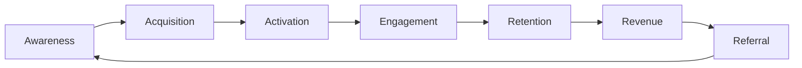
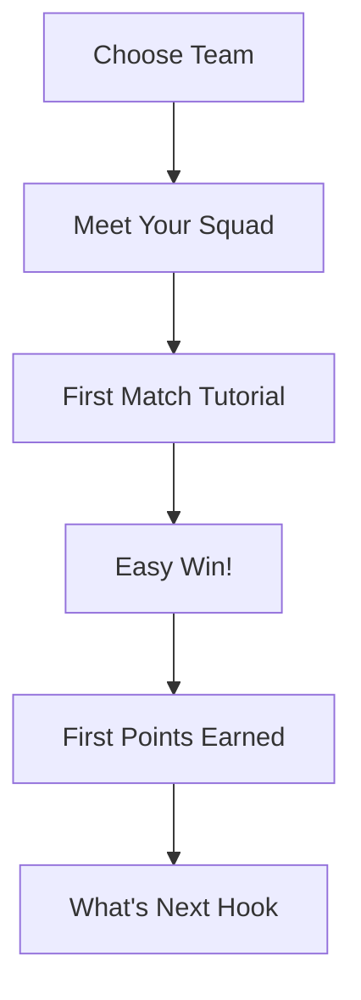
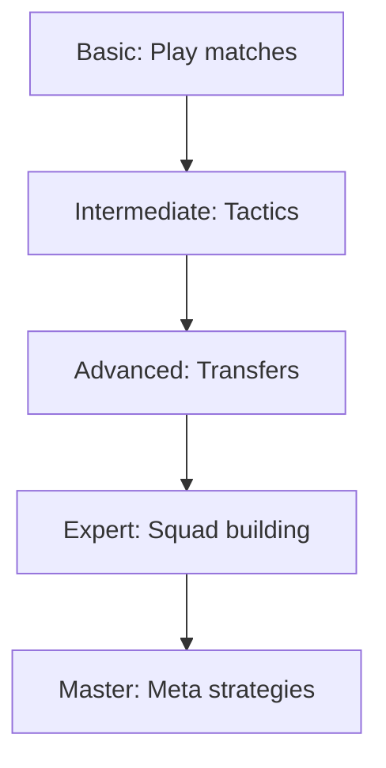
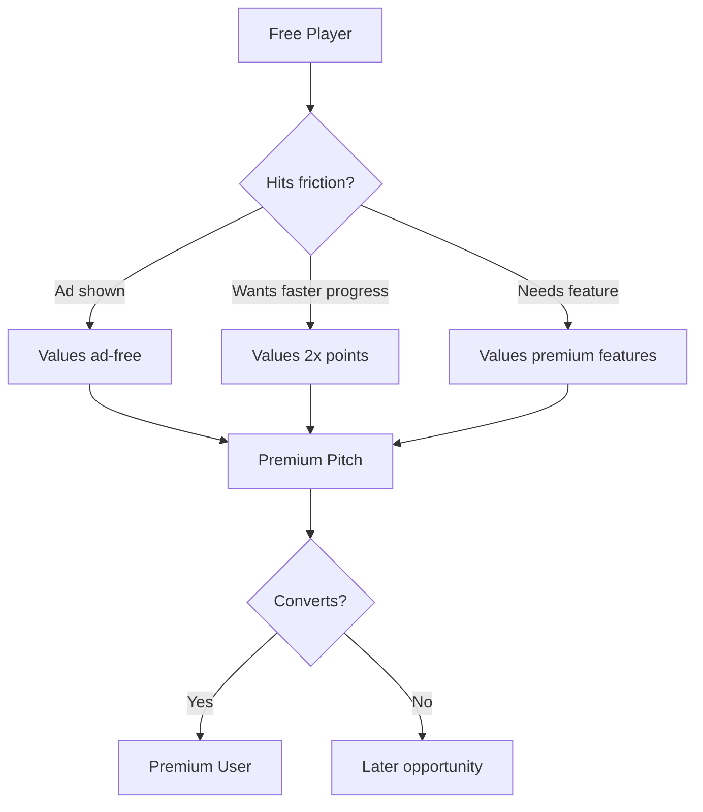

# User Journey

---
tags: #ux #journey #experience #flow
status: updated
priority: high
phase: mvp
last_updated: 2026-03-29
---

> ⚠️ **NOTE:** This document was originally written for a chat-based interface. The game now uses a menu-based, mobile-first dashboard. All conversations with "AI" should be interpreted as interacting with the app's UI elements (buttons, menus, modals).

---

## Overview

The user journey maps the complete experience from discovery to long-term engagement, identifying key moments, emotions, and opportunities.

---

## Migration Note (March 2026)

**Original:** This journey referenced "AI: ..." prompts and chat-based interactions.

**Current:** All interactions are now UI-based:
- Chat prompts → Buttons, menus, modals
- "AI Persona" → UI component states
- Conversational hints → In-app tooltips and feature balances
- Voice/natural language → Touch/tap navigation

**For current interface architecture, see:** [[03-Interface-Architecture]]

---

## Original Journey Phases (Legacy Reference)



---

## Phase 1: Awareness

### Touchpoints

| Channel | Message | Goal |
|---------|---------|------|
| Social Media | "ChatGPT meets Football Manager" | Intrigue |
| Influencer | Gameplay clips, reactions | Social proof |
| Word of Mouth | Friend recommendation | Trust |
| App Store | Screenshots, description | Discovery |

### User Thoughts

> "Wait, you can manage a team just by chatting? That's interesting..."
> "My friend won't stop talking about this game."
> "Earn real fan tokens? How does that work?"

### Success Metrics

- Impressions → Click-through rate: >3%
- Influencer mentions → Install rate: >10%

---

## Phase 2: Acquisition

### First 30 Seconds

```
1. User lands on app/website
2. Sees clean, simple interface
3. Clear value proposition visible
4. "Start Playing" button prominent
5. No signup wall initially
```

### Entry Experience

> ⚠️ **Legacy text describes conversational interface. Current app uses menu-based entry.**

```
1. User lands on app (web or mobile)
2. Sees clean dashboard with onboarding flow
3. Selects team from list (fictional teams - IP safe)
4. Shown dashboard with quick start options:
   - "JOGAR" button (primary)
   - Bottom nav: Elenco, Calendário, Apostas
5. Ready to play - no signup wall
```

### New User Onboarding Flow

See [[02-Onboarding-Flow]] for current onboarding process.

---

### User Emotions

| Moment | Emotion | Design Goal |
|--------|---------|-------------|
| Landing | Curious | Confirm expectations |
| Team selection | Excited | Personal connection |
| First response | Delighted | AI feels smart |

### Success Metrics

- Land to team selection: <30 seconds
- Team selection completion: >90%

---

## Phase 3: Activation (Day 1)

### The Critical First 5 Minutes



### Minute-by-Minute

| Minute | Event | User Feeling |
|--------|-------|--------------|
| 0-1 | Team selection | Anticipation |
| 1-2 | Squad overview | Ownership |
| 2-4 | First match | Engagement |
| 4-5 | Victory + rewards | Success |
| 5+ | Options revealed | Curious |

### Tutorial Flow

```
AI: "🎉 Você é o novo técnico do Flamengo!

Seu elenco está pronto. Aqui estão seus titulares:

[Formation display with top players]

Você tem um jogo amistoso para começar. 
É um adversário fácil - perfeito para sua estreia.

Pronto para seu primeiro jogo?"

User: "Sim" / [Jogar Agora]

AI: "⚽ FLAMENGO 3-1 BOTAFOGO

Que estreia! Seus jogadores mostraram qualidade.

⭐ Destaque: Gabigol (2 gols)
📊 Posse: 58% | Finalizações: 12

Você ganhou: 100 Socios Points! 🎯

O que você gostaria de fazer agora?
1. Jogar outro jogo
2. Ver meu elenco
3. Explorar transferências"
```

### Activation Milestones

| Milestone | Target | Measurement |
|-----------|--------|-------------|
| Complete onboarding | 90% | Funnel analytics |
| Play first match | 85% | Event tracking |
| Return same day | 60% | Session analytics |
| Second session | 50% | Cohort tracking |

---

## Phase 4: Day 1-7 (Engagement)

### Daily Rhythms

```
Day 1: Discover basics, play 3-5 matches
Day 2: Learn tactics, first transfer
Day 3: Understand training, develop player
Day 4: Join first tournament
Day 5: Invite a friend, social features
Day 6: Earn first achievement milestone
Day 7: Streak bonus, week review
```

### Hook Moments

| Day | Hook | Purpose |
|-----|------|---------|
| 2 | "Your next opponent is tough" | Challenge |
| 3 | "Youth player breakthrough" | Discovery |
| 4 | "Weekend tournament starting" | Event |
| 5 | "Derby match approaching" | Anticipation |
| 6 | "Almost at 1,000 points" | Progress |
| 7 | "7-day streak bonus!" | Achievement |

### Engagement Deepening



### Week 1 Metrics

| Metric | Target | Critical? |
|--------|--------|-----------|
| D1 Retention | 60% | Yes |
| D3 Retention | 45% | Yes |
| D7 Retention | 40% | Yes |
| Matches played | 15+ | No |
| Points earned | 1,000+ | No |

---

## Phase 5: Day 8-30 (Retention)

### Habit Formation

| Week | Focus | New Features Unlocked |
|------|-------|----------------------|
| 2 | Regular play pattern | Training, tournaments |
| 3 | First premium consideration | Premium upsell |
| 4 | Social integration | Friends, clubs |

### The 1,000 Point Milestone

```
AI: "🎯 MARCO ALCANÇADO!

Você atingiu 1,000 Socios Points!

Isso significa:
✅ Progresso real em direção a tokens reais
✅ Você está jogando como um técnico de verdade
✅ Mais 9,000 pontos = seu primeiro Fan Token

Próximo objetivo: 2,500 pontos (desbloqueio de conquista)

Continue assim! Seu time precisa de você. ⚽"
```

### Retention Levers

| Lever | Implementation | When to Use |
|-------|----------------|-------------|
| Streak rewards | Daily bonuses | Daily |
| Event urgency | Limited tournaments | Weekly |
| Social pressure | Friend activity | Ongoing |
| Progress anxiety | Almost at milestone | Contextual |
| New content | Features, teams | Monthly |

### Month 1 Metrics

| Metric | Target |
|--------|--------|
| D14 Retention | 30% |
| D30 Retention | 25% |
| Session frequency | 5x/week |
| Avg session length | 12 min |
| Tournament participation | 60% |

---

## Phase 6: Monetization

### Premium Conversion Journey



### Conversion Triggers

| Trigger | Offer | Expected Conversion |
|---------|-------|---------------------|
| 7-day streak | First month 50% off | 15% |
| Tournament loss | "Premium tactics could help" | 5% |
| Slow progress | "2x points speeds things up" | 8% |
| Friend has premium | Social proof | 10% |

### Token Conversion

```
AI: "🎟️ PARABÉNS!

Você alcançou 10,000 Socios Points!

Você desbloqueou: 1 FAN TOKEN VOUCHER

Isso pode ser trocado por um token real do seu clube!

Com tokens reais você pode:
⚽ Votar em decisões do clube
🎟️ Acesso a experiências exclusivas
📈 Valor pode aumentar ao longo do tempo

[Resgatar Agora] [Saber Mais] [Continuar Jogando]"
```

---

## Phase 7: Referral

### Referral Triggers

| Moment | Prompt | Incentive |
|--------|--------|-----------|
| Big win | "Share this victory!" | 50 points |
| Achievement | "Show your badge!" | 100 points |
| Tournament win | "You're champion!" | 200 points |
| Token earned | "You earned real value!" | 500 points (if friend joins) |

### Referral Flow

```
User shares → Friend clicks → Friend signs up → 
Both get 500 points → Friend plays → 
Referrer gets ongoing bonus
```

### Viral Metrics

| Metric | Target |
|--------|--------|
| Shares per user | 2/month |
| Click-through rate | 15% |
| Friend conversion | 25% |
| Viral coefficient | 1.2 |

---

## Emotional Journey Map

```
                     First    First        Streak    First
                     Match    Win          Bonus     Token
                       ↓       ↓             ↓         ↓
Excitement  ▓▓▓▓▓▓▓▓▓▓▓▓▓▓▓▓▓▓▓▓░░░░░░░░░▓▓▓▓▓▓▓▓▓▓▓▓▓▓▓▓
Engagement  ░░░░░▓▓▓▓▓▓▓▓▓▓▓▓▓▓▓▓▓▓▓▓▓▓▓▓▓▓▓▓▓▓▓▓▓▓▓▓▓▓▓
Confidence  ░░░░░░░░░░░▓▓▓▓▓▓▓▓▓▓▓▓▓▓▓▓▓▓▓▓▓▓▓▓▓▓▓▓▓▓▓▓▓
Investment  ░░░░░░░░░░░░░░░░░░░░░░░░▓▓▓▓▓▓▓▓▓▓▓▓▓▓▓▓▓▓▓▓▓
            ─────────────────────────────────────────────→
            Day 1    Day 3    Week 1    Week 2    Month 1
```

---

## Journey Optimization

### Drop-off Points

| Point | Cause | Solution |
|-------|-------|----------|
| Pre-team selection | Unclear value | Better landing page |
| First match | Too complex | Simplify tutorial |
| Day 2 | Forgot about game | Push notification |
| Week 2 | Content exhausted | New features unlock |
| Month 1 | Plateau feeling | Events, challenges |

### Recovery Flows

```
Lapsed 3 days:
"Seu time sente sua falta! 
Você tem 3 jogos pendentes e uma oferta especial esperando."

Lapsed 7 days:
"Enquanto você estava fora: [summary of what happened]
Volte e ganhe 200 pontos de boas-vindas!"

Lapsed 30 days:
"Novo temporada começou! Hora de recomeçar.
Seu time ainda está esperando por você."
```

---

## Related Documents

- [[00-User-Personas]] - Who our users are
- [[02-Onboarding-Flow]] - First-time experience details
- [[01-Gameplay-Loop]] - Core engagement mechanics
- [[02-Analytics-Clustering]] - User behavior tracking

---

*"Every touchpoint is an opportunity to delight or disappoint."*
