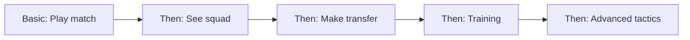

# Onboarding Flow

---
tags: #ux #onboarding #tutorial #ftue
status: complete
priority: critical
phase: planning
last_updated: 2026-01-18
---

## Overview

The onboarding flow (FTUE - First Time User Experience) has one goal: get the player to their first win in under 5 minutes, feeling smart and excited.

> [!important] Golden Rule
> No registration required before first match. Let them play, then ask for account.

---

## Onboarding Principles

### 1. Show, Don't Tell

Instead of explaining, let players discover through action.

| Don't | Do |
|-------|-----|
| "Matches are simulated using..." | Play a match, see the result |
| "Points can be earned by..." | Win and receive points |
| "Tactics affect outcomes..." | Change tactic, see difference |

### 2. Progressive Disclosure

Reveal complexity only as needed.



### 3. Guaranteed Success

First experience must be positive.

- First opponent: Significantly weaker
- First match: Very likely to win
- First reward: Immediate and visible

### 4. Personal Connection

Make it about THEIR team, THEIR story.

```
Good: "Você é o novo técnico do [nome do seu time]!"
Bad: "Escolha um time para jogar"
```

---

## Step-by-Step Flow

### Step 1: Landing (0-30 seconds)

```
┌────────────────────────────────────┐
│                                    │
│      🎯 FALA MESTRE!              │
│                                    │
│   O jogo onde você é o técnico    │
│   Gerencie seu time conversando   │
│                                    │
│      [COMEÇAR A JOGAR]            │
│                                    │
│   Sem cadastro necessário         │
│                                    │
└────────────────────────────────────┘
```

**User Action:** Tap "Começar a Jogar"
**Metric:** Time to tap: <10 seconds

### Step 2: Create Your Team (30-60 seconds)

**Step 2a: Choose Team Name**
```
AI: "👋 E aí! Vamos começar.

Primeiro, qual vai ser o nome do seu time?

💡 Pode ser qualquer nome! Exemplos:
• Dragões do Cerrado
• Águias da Liberdade
• Os Invencíveis do Sul

📝 Digite o nome do seu time"
```

**Step 2b: Pick Your Colors**
```
AI: "Show! Agora escolha as cores do seu time:

[🔴⚫ Vermelho e Preto]  [⚪🟢 Branco e Verde]
[🔵⚪ Azul e Branco]     [💛🟢 Amarelo e Verde]
[⚫⚪ Preto e Branco]     [🎨 Escolher outras cores]"
```

**Step 2c: Choose Badge Style**
```
AI: "Perfeito! Escolha o estilo do escudo:

[🛡️ Escudo Clássico]  [⭕ Círculo Moderno]
[🔷 Losango]          [🏛️ Brasão Elegante]"
```

**User Action:** Type name, pick colors, choose badge
**Metric:** Selection completion: >95%

### Step 3: Welcome Message (60-90 seconds)

```
AI: "🎉 PARABÉNS!

Você é o novo técnico do [nome do seu time]!

Aqui está seu elenco:

┌─────────────────────────────────────┐
│           RAIO (87)                 │
│        ⭐ Artilheiro do time        │
│                                     │
│    O MAGO        TROVÃO            │
│       (85)          (84)            │
│                                     │
│  CAPITÃO   SOMBRA   FOGUETE       │
│   (84)    (82)        (84)          │
│                                     │
│ MURALHA  PANTERA  TITAN   RELÂMPAGO│
│  (82)    (83)    (81)      (80)     │
│                                     │
│           PAREDÃO (81)              │
└─────────────────────────────────────┘

Seu primeiro jogo é contra o Trovão FC - um adversário mais fraco.
Perfeito para sua estreia!

[JOGAR PRIMEIRO JOGO]"
```

**User Action:** Tap to play
**Emotion:** Ownership, anticipation
**Metric:** Proceed to match: >90%

### Step 4: First Match (90-180 seconds)

#### Pre-Match

```
AI: "⚽ [SEU TIME] vs TROVÃO FC

📍 Estádio Municipal | 🏆 Amistoso

Seu time está motivado para sua estreia!

Formação: 4-3-3 (recomendada para você)
Tática: Equilibrada

[INICIAR PARTIDA]

💡 Dica: Em jogos futuros, você poderá ajustar 
táticas e formação. Por enquanto, vamos jogar!"
```

#### Match Simulation (Simplified)

```
AI: "⚽ JOGO AO VIVO

0' - Começa o jogo!

15' - Seu time domina a posse de bola...

23' - ⚽ GOOOL! Raio recebe de O Mago e 
     finaliza no canto! [SEU TIME] 1-0!

38' - Quase! O Mago acerta a trave!

45' - Fim do primeiro tempo. [SEU TIME] 1-0.

─────────────────────────────────

52' - ⚽ GOOOL! Trovão com um chute de fora 
     da área! [SEU TIME] 2-0!

71' - Trovão FC diminui. 2-1.

85' - ⚽ GOOOL! Raio de novo! HAT-TRICK!
     [SEU TIME] 3-1!

90' - APITO FINAL!

🏆 [SEU TIME] 3-1 TROVÃO FC

Que estreia, técnico! 🔥"
```

**Duration:** ~45 seconds of text flow
**Emotion:** Excitement, success
**Metric:** Match completion: >98%

### Step 5: Post-Match Celebration (180-240 seconds)

```
AI: "🎉 VITÓRIA NA ESTREIA!

📊 ESTATÍSTICAS
• Posse de bola: 62%
• Finalizações: 14 (6 no gol)
• Passes certos: 89%

⭐ DESTAQUE: Raio (9.5)
   2 gols + 1 assistência

💰 RECOMPENSAS GANHAS:
• +100 Socios Points (vitória)
• +50 Socios Points (bônus estreia)
• +25 Socios Points (goleada)
= 175 Socios Points! 🎯

─────────────────────────────────────

Seu progresso para o primeiro Fan Token:
[█░░░░░░░░░] 175 / 10,000 (2%)

Continue jogando para ganhar mais!

O que você quer fazer agora?

[Jogar Outro Jogo]  [Ver Meu Elenco]  [Explorar]"
```

**Emotion:** Pride, curiosity about tokens
**Metric:** Continue playing: >80%

### Step 6: Account Creation (After 2-3 matches)

```
AI: "⚠️ SALVAR SEU PROGRESSO

Você já tem:
• 450 Socios Points
• 3 vitórias consecutivas
• Raio em ótima forma

Crie uma conta gratuita para:
✅ Salvar seu progresso
✅ Jogar em qualquer dispositivo
✅ Receber notificações de jogos
✅ Resgatar tokens no futuro

[Criar Conta com Email]
[Continuar com Google]
[Continuar com Apple]

[Talvez Depois] - risco de perder progresso"
```

**Timing:** After emotional investment
**Metric:** Account creation: >70%

---

## Onboarding Variations

### By Persona

#### Casual Carlos

- Shortest possible tutorial
- Maximum hand-holding
- Emphasize fun, not complexity
- Show "quick session" promise

#### Tactical Thiago

- Show tactical depth exists
- Mention advanced features coming
- Less hand-holding welcome
- Competitive angle early

#### Social Sofia

- Early mention of friend features
- Show sharing capability
- Community aspect visible
- Social proof elements

#### Crypto Pedro

- Token earning prominent
- Fair economy explanation
- Professional presentation
- Value proposition clear

### By Entry Point

| Source | Adjustment |
|--------|------------|
| Influencer link | Reference influencer |
| App Store | Standard flow |
| Friend referral | Mention friend |
| Ad click | Reinforce ad promise |

---

## Tutorial Deep Dive

### Tutorial Principles

1. **Interruptible:** Player can skip at any time
2. **Contextual:** Tips appear when relevant
3. **Optional:** Core actions work without reading
4. **Rewarding:** Completing tutorial gives bonus

### Tutorial Moments

| Moment | Teaching | Method |
|--------|----------|--------|
| First match | Match flow | Guided first match |
| First points | Economy | Celebration message |
| Squad view | Player stats | Highlighted card |
| First transfer | Market | Guided purchase |
| First training | Development | Simple assignment |
| First tournament | Events | Invitation prompt |

### Contextual Tips

```
First time viewing squad:
💡 "Toque em qualquer jogador para ver suas estatísticas"

First time in transfer market:
💡 "Você pode oferecer abaixo do valor e negociar"

First time losing:
💡 "Derrotas acontecem! Tente ajustar sua tática"

First time at 1000 points:
💡 "Continue assim! 10,000 pontos = 1 Fan Token real"
```

---

## Metrics & Goals

### Funnel Metrics

| Step | Target | Critical? |
|------|--------|-----------|
| Land → Team Select | 95% | Yes |
| Team Select → Match | 90% | Yes |
| Match → Complete | 98% | Yes |
| Complete → Continue | 80% | Yes |
| Day 1 → Day 2 Return | 60% | Yes |
| Day 1 → Account Create | 70% | No |

### Time Metrics

| Milestone | Target |
|-----------|--------|
| First match start | <2 min |
| First match complete | <5 min |
| First account create | <10 min |
| First transfer | <15 min |

### Quality Metrics

| Metric | Target |
|--------|--------|
| Tutorial completion | 85% |
| Skip rate | <20% |
| First session length | >10 min |
| First session matches | 2+ |

---

## Edge Cases

### Returning Without Account

```
AI: "👋 Bem-vindo de volta!

Encontrei um jogo anterior neste dispositivo:
• Time: [Nome do Time]
• Pontos: 450
• Última sessão: ontem

[Continuar Este Jogo]
[Começar Novo Jogo]

💡 Crie uma conta para nunca perder seu progresso!"
```

### Very Fast Players

If player tries to skip too quickly:

```
AI: "Calma, técnico! 😄

Entendo a empolgação, mas vamos pelo menos 
jogar uma partida juntos para eu entender 
seu estilo.

[OK, Vamos Lá!]"
```

### Confused Players

If player seems stuck:

```
AI: "Precisa de ajuda? 🤔

Posso explicar:
1. Como jogar uma partida
2. Como funciona o elenco
3. O que são Socios Points
4. Como ganhar Fan Tokens

Ou só diga 'jogar' e vamos direto para a ação!"
```

---

## Related Documents

- [[01-User-Journey]] - Full journey context
- [[00-User-Personas]] - User types
- [[03-Conversational-Interface]] - UI patterns
- [[01-Gameplay-Loop]] - Post-onboarding flow
- [[19-IP-Protection-Team-Naming-Strategy]] - IP-safe team creation approach

---

*"The best onboarding feels like playing, not learning."*
