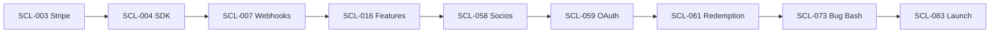

# Scale Tasks (Phase 3)

---
tags: #tasks #scale #phase-3 #monetization #launch #tracking
status: active
priority: high
phase: scale
last_updated: 2026-01-19
---

## Overview

Detailed task breakdown for Phase 3 (Scale). Total: 62 tasks over 4 weeks (Weeks 9-12).

> [!note] Phase 3 Focus
> Monetization, social features, token integration, and public launch.

---

## Week 9: Monetization (Day 57-63)

### Premium Subscription System

| ID | Task | Priority | Hours | Deps | Status |
|----|------|----------|-------|------|--------|
| SCL-001 | Create subscriptions database table | P0 | 2h | ENH-060 | [ ] |
| SCL-002 | Design subscription tiers (Free, Premium) | P0 | 2h | - | [ ] |
| SCL-003 | Set up Stripe account and API keys | P0 | 1h | - | [ ] |
| SCL-004 | Implement Stripe SDK integration | P0 | 3h | SCL-003 | [ ] |
| SCL-005 | Create checkout session API endpoint | P0 | 3h | SCL-004 | [ ] |
| SCL-006 | Build subscription purchase UI in chat | P0 | 4h | SCL-005 | [ ] |
| SCL-007 | Implement webhook handler for Stripe events | P0 | 4h | SCL-004 | [ ] |
| SCL-008 | Create subscription status sync | P0 | 2h | SCL-007 | [ ] |
| SCL-009 | Build subscription management page | P1 | 3h | SCL-008 | [ ] |
| SCL-010 | Implement subscription cancellation flow | P0 | 2h | SCL-009 | [ ] |

### PIX Payments (Brazil)

| ID | Task | Priority | Hours | Deps | Status |
|----|------|----------|-------|------|--------|
| SCL-011 | Set up PIX via Stripe Brazil | P0 | 2h | SCL-004 | [ ] |
| SCL-012 | Create PIX payment flow | P0 | 3h | SCL-011 | [ ] |
| SCL-013 | Build PIX QR code display | P0 | 2h | SCL-012 | [ ] |
| SCL-014 | Implement PIX payment confirmation | P0 | 2h | SCL-012 | [ ] |
| SCL-015 | Add PIX payment receipts | P1 | 1h | SCL-014 | [ ] |

### Premium Features

| ID | Task | Priority | Hours | Deps | Status |
|----|------|----------|-------|------|--------|
| SCL-016 | Create feature flags system | P0 | 2h | SCL-001 | [ ] |
| SCL-017 | Implement 2x points multiplier for premium | P0 | 2h | SCL-016 | [ ] |
| SCL-018 | Add premium badge display | P1 | 1h | SCL-016 | [ ] |
| SCL-019 | Implement ad-free experience flag | P0 | 1h | SCL-016 | [ ] |
| SCL-020 | Create premium-only tournaments access | P1 | 2h | SCL-016 | [ ] |

---

## Week 10: Advertising & Social (Day 64-70)

### Ad Integration

| ID | Task | Priority | Hours | Deps | Status |
|----|------|----------|-------|------|--------|
| SCL-021 | Set up AdMob/IronSource account | P1 | 1h | - | [ ] |
| SCL-022 | Integrate rewarded video SDK | P1 | 4h | SCL-021 | [ ] |
| SCL-023 | Create rewarded video trigger points | P1 | 2h | SCL-022 | [ ] |
| SCL-024 | Implement reward delivery after video | P1 | 2h | SCL-023 | [ ] |
| SCL-025 | Add daily ad limits (5/day) | P1 | 1h | SCL-024 | [ ] |
| SCL-026 | Create interstitial ad placements | P2 | 2h | SCL-021 | [ ] |
| SCL-027 | Implement ad frequency capping | P1 | 1h | SCL-026 | [ ] |
| SCL-028 | Build ad analytics tracking | P1 | 2h | SCL-022 | [ ] |

### Friend System

| ID | Task | Priority | Hours | Deps | Status |
|----|------|----------|-------|------|--------|
| SCL-029 | Create friends database table | P1 | 2h | ENH-060 | [ ] |
| SCL-030 | Create friend_requests table | P1 | 1h | SCL-029 | [ ] |
| SCL-031 | Build friend request API endpoints | P1 | 3h | SCL-030 | [ ] |
| SCL-032 | Implement friend search by username | P1 | 2h | SCL-031 | [ ] |
| SCL-033 | Create friend request notification | P1 | 2h | SCL-031 | [ ] |
| SCL-034 | Build friend list UI card | P1 | 2h | SCL-029 | [ ] |
| SCL-035 | Add friend activity feed | P2 | 3h | SCL-034 | [ ] |
| SCL-036 | Implement friend leaderboard | P1 | 2h | SCL-029 | [ ] |

### Async PvP

| ID | Task | Priority | Hours | Deps | Status |
|----|------|----------|-------|------|--------|
| SCL-037 | Create pvp_matches database table | P1 | 2h | SCL-029 | [ ] |
| SCL-038 | Build challenge friend API | P1 | 3h | SCL-037 | [ ] |
| SCL-039 | Implement async match simulation | P1 | 4h | SCL-038 | [ ] |
| SCL-040 | Create match result notification | P1 | 2h | SCL-039 | [ ] |
| SCL-041 | Build PvP result card | P1 | 2h | SCL-039 | [ ] |
| SCL-042 | Implement rematch functionality | P2 | 2h | SCL-041 | [ ] |
| SCL-043 | Add PvP ranking impact | P1 | 2h | SCL-039 | [ ] |

---

## Week 11: Virality & Tokens (Day 71-77)

### Sharing Features

| ID | Task | Priority | Hours | Deps | Status |
|----|------|----------|-------|------|--------|
| SCL-044 | Create share card image generator | P0 | 4h | - | [ ] |
| SCL-045 | Build match result share card | P0 | 3h | SCL-044 | [ ] |
| SCL-046 | Build achievement share card | P1 | 2h | SCL-044 | [ ] |
| SCL-047 | Implement Web Share API | P0 | 2h | SCL-044 | [ ] |
| SCL-048 | Add WhatsApp deep link sharing | P0 | 2h | SCL-047 | [ ] |
| SCL-049 | Add Instagram story sharing | P1 | 3h | SCL-044 | [ ] |
| SCL-050 | Create share tracking analytics | P0 | 2h | SCL-047 | [ ] |

### Referral System

| ID | Task | Priority | Hours | Deps | Status |
|----|------|----------|-------|------|--------|
| SCL-051 | Create referrals database table | P0 | 2h | ENH-060 | [ ] |
| SCL-052 | Generate unique referral codes | P0 | 2h | SCL-051 | [ ] |
| SCL-053 | Build referral link generator | P0 | 1h | SCL-052 | [ ] |
| SCL-054 | Implement referral tracking | P0 | 3h | SCL-053 | [ ] |
| SCL-055 | Create referral reward system (500 pts) | P0 | 2h | SCL-054 | [ ] |
| SCL-056 | Build referral dashboard UI | P1 | 2h | SCL-054 | [ ] |
| SCL-057 | Add ongoing referral bonuses | P2 | 2h | SCL-055 | [ ] |

### Token Integration

| ID | Task | Priority | Hours | Deps | Status |
|----|------|----------|-------|------|--------|
| SCL-058 | Research Socios.com API documentation | P0 | 4h | - | [ ] |
| SCL-059 | Implement Socios OAuth flow | P0 | 6h | SCL-058 | [ ] |
| SCL-060 | Create token_claims database table | P0 | 2h | SCL-059 | [ ] |
| SCL-061 | Build voucher redemption API | P0 | 4h | SCL-060 | [ ] |
| SCL-062 | Create token selection UI | P0 | 3h | SCL-061 | [ ] |
| SCL-063 | Implement redemption confirmation flow | P0 | 3h | SCL-062 | [ ] |
| SCL-064 | Add redemption history view | P1 | 2h | SCL-063 | [ ] |
| SCL-065 | Create balance sync with Socios | P1 | 3h | SCL-059 | [ ] |

---

## Week 12: Launch Preparation (Day 78-84)

### Performance & Security

| ID | Task | Priority | Hours | Deps | Status |
|----|------|----------|-------|------|--------|
| SCL-066 | Performance audit (Lighthouse) | P0 | 3h | All | [ ] |
| SCL-067 | Optimize bundle size | P0 | 4h | SCL-066 | [ ] |
| SCL-068 | Implement lazy loading | P0 | 2h | SCL-067 | [ ] |
| SCL-069 | Security audit (OWASP check) | P0 | 4h | All | [ ] |
| SCL-070 | Rate limiting implementation | P0 | 2h | SCL-069 | [ ] |
| SCL-071 | SQL injection prevention review | P0 | 2h | SCL-069 | [ ] |
| SCL-072 | API endpoint hardening | P0 | 3h | SCL-069 | [ ] |

### Bug Fixes & Testing

| ID | Task | Priority | Hours | Deps | Status |
|----|------|----------|-------|------|--------|
| SCL-073 | Bug bash session | P0 | 8h | All | [ ] |
| SCL-074 | Critical bug fixes | P0 | 12h | SCL-073 | [ ] |
| SCL-075 | Mobile device testing (5+ devices) | P0 | 4h | All | [ ] |
| SCL-076 | Cross-browser testing | P0 | 3h | All | [ ] |
| SCL-077 | Load testing (1000 concurrent) | P0 | 4h | All | [ ] |

### Launch Execution

| ID | Task | Priority | Hours | Deps | Status |
|----|------|----------|-------|------|--------|
| SCL-078 | Create marketing launch assets | P0 | 4h | - | [ ] |
| SCL-079 | Prepare influencer outreach kit | P0 | 3h | SCL-078 | [ ] |
| SCL-080 | Set up launch monitoring dashboard | P0 | 2h | SCL-066 | [ ] |
| SCL-081 | Configure error alerting (Sentry) | P0 | 2h | - | [ ] |
| SCL-082 | Prepare rollback plan | P0 | 2h | - | [ ] |
| SCL-083 | Execute public launch | P0 | 4h | All | [ ] |
| SCL-084 | Monitor first 24 hours | P0 | 8h | SCL-083 | [ ] |

---

## Task Checklist Summary

```
WEEK 9 TASKS (Monetization)
===========================
[ ] SCL-001 through SCL-020 (20 tasks)
Estimated: 44 hours

WEEK 10 TASKS (Ads & Social)
============================
[ ] SCL-021 through SCL-043 (23 tasks)
Estimated: 52 hours

WEEK 11 TASKS (Virality & Tokens)
=================================
[ ] SCL-044 through SCL-065 (22 tasks)
Estimated: 56 hours

WEEK 12 TASKS (Launch)
======================
[ ] SCL-066 through SCL-084 (19 tasks)
Estimated: 70 hours

TOTAL: 84 tasks, 222 hours
```

---

## Priority Breakdown

| Priority | Tasks | Hours | Focus |
|----------|-------|-------|-------|
| P0 | 52 | 158h | Payments, tokens, launch |
| P1 | 24 | 50h | Ads, social, PvP |
| P2 | 8 | 14h | Nice-to-haves |

---

## Dependencies Diagram

```
Enhancement Phase
    |
    +-- ENH-060 (Soft Launch) --+-- SCL-001 (Subscriptions)
                                |       |
                                |       +-- SCL-004 (Stripe)
                                |               |
                                |               +-- SCL-011 (PIX)
                                |               |
                                |               +-- SCL-016 (Features)
                                |
                                +-- SCL-029 (Friends)
                                |       |
                                |       +-- SCL-037 (PvP)
                                |       |
                                |       +-- SCL-036 (Leaderboard)
                                |
                                +-- SCL-051 (Referrals)
                                        |
                                        +-- SCL-054 (Tracking)
                                        |
                                        +-- SCL-055 (Rewards)

Token Integration
    |
    +-- SCL-058 (Research) --+-- SCL-059 (OAuth)
                             |       |
                             |       +-- SCL-061 (Redemption)
                             |       |
                             |       +-- SCL-065 (Sync)
                             |
                             +-- SCL-060 (Claims Table)
```

---

## Critical Path

The following tasks are on the critical path to launch:



---

## Risk Items

| Risk | Impact | Mitigation |
|------|--------|------------|
| Stripe Brazil approval delay | High | Start application early, have backup processor |
| Socios API complexity | High | Start integration early, prepare mock fallback |
| Ad revenue lower than expected | Medium | Focus on subscriptions as primary revenue |
| Launch day server overload | High | Load test, prepare scaling plan |
| Payment fraud | Medium | Implement fraud detection rules |

---

## Integration Points

### External Services

| Service | Purpose | Account Setup |
|---------|---------|---------------|
| Stripe | Payments (cards, PIX) | Week 9, Day 1 |
| AdMob/IronSource | Advertising | Week 10, Day 1 |
| Socios.com | Token redemption | Week 11, Day 1 |
| Branch.io | Deep linking | Week 11, Day 2 |
| Sentry | Error monitoring | Week 12, Day 1 |

### API Endpoints Created

| Endpoint | Method | Purpose |
|----------|--------|---------|
| `/api/payments/checkout` | POST | Create checkout session |
| `/api/payments/webhook` | POST | Handle Stripe events |
| `/api/friends/request` | POST | Send friend request |
| `/api/friends/list` | GET | Get friend list |
| `/api/pvp/challenge` | POST | Challenge friend |
| `/api/share/card` | GET | Generate share image |
| `/api/referral/track` | POST | Track referral |
| `/api/tokens/redeem` | POST | Redeem voucher |

---

## Definition of Done

Each task is "Done" when:

1. [ ] Code written and working
2. [ ] Unit tests passing (where applicable)
3. [ ] Integration tested with external services
4. [ ] Mobile-responsive (if UI)
5. [ ] Security reviewed (for payment/auth)
6. [ ] Deployed to staging
7. [ ] Product owner approved

---

## Launch Checklist

### Pre-Launch (Day 77)

- [ ] All P0 tasks complete
- [ ] Security audit passed
- [ ] Load testing passed
- [ ] Payment flows tested end-to-end
- [ ] Token redemption tested
- [ ] Monitoring in place

### Launch Day (Day 78)

- [ ] Team on standby
- [ ] Rollback plan ready
- [ ] Marketing assets live
- [ ] Influencer posts scheduled
- [ ] Support channels active

### Post-Launch (Day 79-84)

- [ ] Monitor metrics hourly
- [ ] Respond to critical bugs <1h
- [ ] Daily performance review
- [ ] User feedback collection
- [ ] Iterate based on data

---

## Related Documents

- [[00-Task-Index]] - Master task index
- [[02-Enhancement-Tasks]] - Previous phase tasks
- [[04-Expansion-Tasks]] - Next phase tasks
- [[03-Phase-3-Scale]] - Phase overview
- [[00-Monetization]] - Revenue model
- [[01-Fan-Token-Integration]] - Token system

---

*"Launch is not the end, it's the beginning of the real work."*
