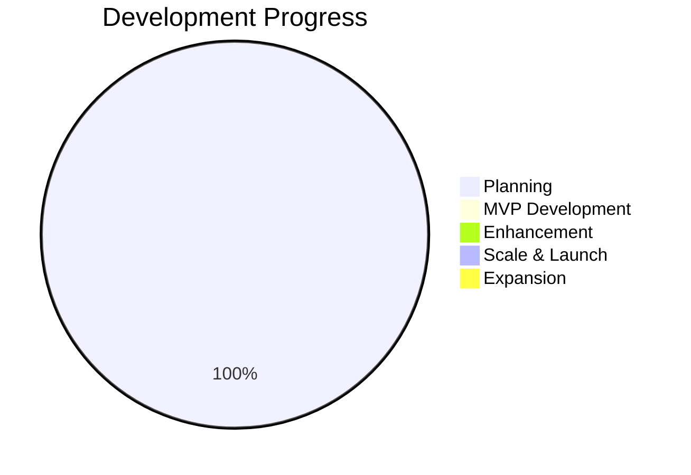

# Fala Mestre! - Documentation Vault

---
tags: #index #home #navigation
status: active
version: 1.0
last_updated: 2026-02-07
---

## Welcome to Fala Mestre!

> **"The future of football gaming isn't on a screen - it's in a conversation."**

Fala Mestre! is an **AI-powered conversational football management game** that combines classic Elifoot-style gameplay with an AI assistant coach. Players manage a fictional Brazilian football club through natural language conversation and a mobile-first UI.

Fala Mestre! is a standalone game; it has no crypto or ad-platform integrations.

---

## Quick Navigation

### Core Documentation

| Section | Description | Key Documents |
|---------|-------------|---------------|
| [[00-Executive-Summary]] | Project overview | Vision, design goals, approach |
| [[01-Vision-and-Strategy]] | Strategic positioning and goals | Market position, success factors |
| [[02-Market-Analysis]] | Target market and competition | Brazil focus, competitive landscape |

### Game Design

| Section | Description | Key Documents |
|---------|-------------|---------------|
| [[00-Core-Concept]] | Fundamental game philosophy | Conversational AI + Football Manager |
| [[01-Gameplay-Loop]] | Core engagement mechanics | Play, earn, improve cycle |
| [[02-Player-System]] | Player attributes and ratings | 6-attribute system, hidden stats |
| [[03-Match-Simulation]] | Match engine and outcomes | Probability engine, narratives |
| [[03-Match-Simulation-VR]] | VR match view concept | Immersive match viewing |
| [[04-Transfer-Market]] | Trading and negotiations | AI negotiation, valuations |
| [[05-Training-Development]] | Player growth systems | Training, youth academy |
| [[06-Virtual-Fanbase]] | Fan faction mechanics | 4 factions, mood system |
| [[07-Formations-Tactics]] | Tactical systems | Formations, matchups |
| [[08-Points-Rewards]] | Economy and rewards | Earning, spending, anti-abuse |

### User Experience

| Section | Description | Key Documents |
|---------|-------------|---------------|
| [[00-User-Personas]] | Target user profiles | 3 primary personas |
| [[01-User-Journey]] | End-to-end user flow | First 30 days experience |
| [[02-Onboarding-Flow]] | New user experience | Team selection, tutorial |
| [[03-Conversational-Interface]] | Original chat UI (deprecated) | History of the chat-only design |
| [[03-Interface-Architecture]] | Current interface architecture | Menu-based navigation, pages |
| [[04-Visual-Design]] | Art direction and assets | Style guide, Rive animations |

### Layout Enhancement Suggestions

#### Current Layout Analysis

The current MVP implementation features a functional but basic layout that serves the core gameplay needs:

**Strengths:**
- Clean, minimalist interface that doesn't distract from gameplay
- Mobile-responsive design that works across devices
- Clear visual hierarchy for primary actions (chat, match, squad)
- Consistent use of Tailwind CSS utilities for styling
- Proper spacing and alignment following design principles

**Areas for Enhancement:**
- Limited visual feedback during interactions
- Minimal use of animations and micro-interactions
- Basic typography that could be more engaging
- Underutilized screen real estate on larger displays
- Limited visual storytelling elements

#### Proposed Visual Improvements

##### 1. Enhanced Typography System
```
Current: Basic system fonts
Proposed: Custom font pairing with Brazilian football aesthetics
- Headers: Bold, athletic-inspired typefaces
- Body: Clean, readable fonts with good legibility
- UI Elements: Consistent font weights and sizes
```

##### 2. Color Psychology Implementation
```
Current: Basic color scheme
Proposed: Emotion-driven color palette
- Success states: Green gradients (victory celebrations)
- Warning states: Yellow/orange (caution, low energy)
- Error states: Red tones (defeat, injuries)
- Primary actions: Blue/cyan (trust, forward momentum)
```

##### 3. Animation Framework
```
Current: No animations
Proposed: Layered animation system
- Micro-interactions: Button hover states, loading indicators
- Micro-celebrations: Goal celebrations, win animations
- Page transitions: Smooth navigation between sections
- Character animations: Rive-powered coach/player movements
```

##### 4. Visual Hierarchy Enhancement
```
Current: Basic card-based layout
Proposed: Multi-level visual hierarchy
- Primary content: Centered, high-contrast
- Secondary actions: Subtle, accessible
- Status indicators: Color-coded, animated
- Progress visualization: Dynamic progress bars
```

##### 5. Responsive Design Optimization
```
Current: Basic responsive breakpoints
Proposed: Device-specific optimizations
- Mobile: Thumb-friendly touch targets, vertical scrolling
- Tablet: Split-screen layouts, enhanced controls
- Desktop: Multi-pane layouts, keyboard shortcuts
- Large screens: Extended information displays
```

#### User Experience Impact

**Immediate Benefits:**
- ✅ Increased user engagement through visual feedback
- ✅ Improved emotional connection with game events
- ✅ Enhanced accessibility and usability
- ✅ Stronger brand identity and recognition
- ✅ Better information hierarchy and comprehension

**Long-term Benefits:**
- ✅ Higher retention rates through engaging visuals
- ✅ Increased time spent in the app
- ✅ Better conversion from free to premium users
- ✅ Stronger emotional attachment to the game
- ✅ Competitive advantage in the market

#### Implementation Priority

| Enhancement | Priority | Timeline | Impact |
|-------------|----------|----------|--------|
| Typography System | High | Week 1-2 | Medium |
| Color Psychology | High | Week 2-3 | High |
| Animation Framework | Medium | Week 3-4 | High |
| Visual Hierarchy | Medium | Week 4-5 | Medium |
| Responsive Optimization | Low | Week 5-6 | Low |

#### Technical Considerations

- **Performance:** Animations should be GPU-accelerated and optimized
- **Accessibility:** All enhancements must meet WCAG 2.1 AA standards
- **Cross-browser:** Consistent experience across modern browsers
- **Mobile-first:** Design for touch interactions first
- **Progressive enhancement:** Core functionality remains accessible without enhanced visuals

#### Reference Implementation

The proposed enhancements align with the existing tech stack:
- **Next.js 14:** Built-in support for CSS-in-JS and animations
- **Tailwind CSS:** Utility-first approach for consistent styling
- **shadcn/ui:** Component library with good foundation for enhancements
- **Rive:** Already planned for character animations
- **TypeScript:** Type-safe implementation of design system

These visual improvements will transform the functional MVP into an engaging, emotionally resonant football management experience that captures the passion and excitement of Brazilian football culture.

### Technical Architecture

| Section | Description | Key Documents |
|---------|-------------|---------------|
| [[00-System-Overview]] | High-level architecture | System diagram, data flow |
| [[01-Tech-Stack]] | Technology choices | Next.js, Supabase, Claude |
| [[02-Database-Schema]] | Data model design | Tables, relationships, RLS |
| [[03-API-Design]] | API endpoints and contracts | REST routes, WebSocket |
| [[04-AI-LLM-Strategy]] | AI integration approach | Tiered models, prompts |
| [[05-Caching-Performance]] | Performance optimization | Multi-layer cache, CDN |
| [[10-Three-Tier-LLM-Strategy]] | LLM model tiers | Model selection and routing |

### Business

| Section | Description | Key Documents |
|---------|-------------|---------------|
| [[19-IP-Protection-Team-Naming-Strategy]] | IP-safe naming strategy | Fictional teams, generated players, legal protection |

### Development Roadmap

| Phase | Timeline | Key Deliverables |
|-------|----------|------------------|
| [[01-Phase-1-MVP]] | Weeks 1-4 | Core gameplay, match engine, basic rewards |
| [[02-Phase-2-Enhancement]] | Weeks 5-8 | Training, tournaments, social features |
| [[03-Phase-3-Scale]] | Weeks 9-12 | PvP, premium features, public launch |
| [[04-Phase-4-Expansion]] | Months 4-6 | Real-time PvP, advanced features |
| [[05-Phase-5-Global]] | Months 7-12 | International expansion, multi-language |

### Task Tracking

| Document | Description |
|----------|-------------|
| [[00-Task-Index]] | Master task overview and status |
| [[01-MVP-Tasks]] | Phase 1 atomic tasks (50+ tasks) |
| [[02-Enhancement-Tasks]] | Phase 2 atomic tasks (40+ tasks) |
| [[03-Scale-Tasks]] | Phase 3 atomic tasks (35+ tasks) |
| [[04-Expansion-Tasks]] | Phase 4-5 atomic tasks (75+ tasks) |
| [[02-VR-Tasks]] | VR match view tasks |
| [[VR-Phase2-3D-Models]] | VR 3D model tasks |

### Evaluations

| Document | Description |
|----------|-------------|
| [[00-Evaluation-Criteria]] | Evaluation rubric |
| [[01-Comprehensive-Evaluation-2026-02-06]] | Project evaluation (Feb 2026) |
| [[02-Quick-Wins-Plan]] | Quick wins identified by the evaluation |

### Templates

| Document | Description |
|----------|-------------|
| [[DESIGN_SYSTEM]] | Design system reference |
| [[SCREENS_PLAN]] | Screen-by-screen design plan |

---

## Project Status



### Current Phase: **Planning Complete**

| Milestone | Status | Target Date |
|-----------|--------|-------------|
| Documentation Complete | Done | Jan 2026 |
| MVP Development Start | Pending | Feb 2026 |
| MVP Launch | Pending | Mar 2026 |
| Public Launch | Pending | Apr 2026 |

---

## Brand Identity

| Element | Value |
|---------|-------|
| **Name** | Fala Mestre! ("Talk to the Master/Coach") |
| **Domain** | falamestre.ai |
| **Target Market** | Brazilian football fans (70M+) |
| **Positioning** | ChatGPT meets Football Manager |
| **Tone** | Passionate, authentic, accessible |

---

## How to Use This Vault

### Navigation
- Use `[[wiki links]]` to navigate between documents
- Use tags (`#tag`) to filter related content
- Use the graph view to explore connections
- Use search (`Ctrl+O`) to find specific topics

### Tags System
- `#phase-1` through `#phase-5` - Development phases
- `#mvp` - MVP-critical features
- `#priority-high/medium/low` - Task priorities
- `#frontend` `#backend` `#ai` `#game-logic` - Technical areas
- `#business` `#design` `#technical` - Document types

---

## Quick Links

- **Start Here:** [[00-Executive-Summary]]
- **Game Design:** [[00-Core-Concept]]
- **Technical:** [[00-System-Overview]]
- **Tasks:** [[00-Task-Index]]
- **Roadmap:** [[00-Development-Phases]]

---

*Document maintained by: Project Team*
*Last sync: 2026-01-18*
